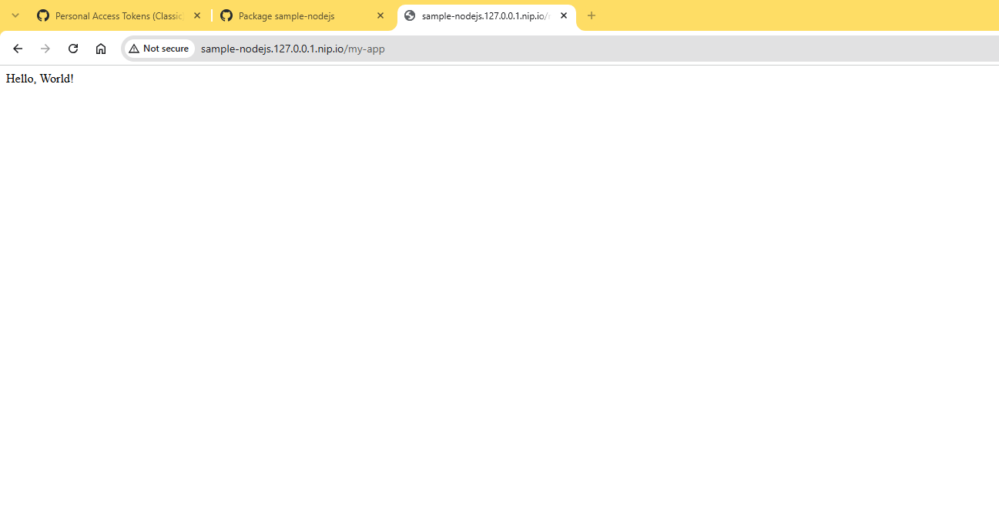
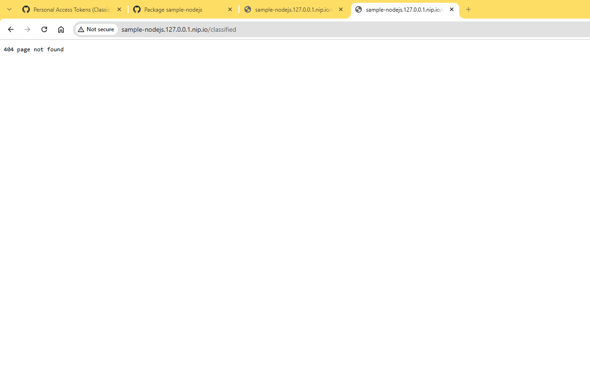
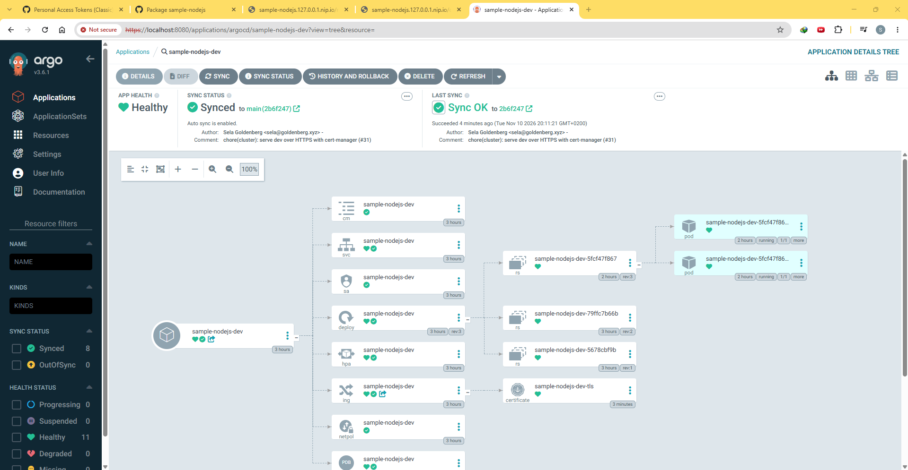
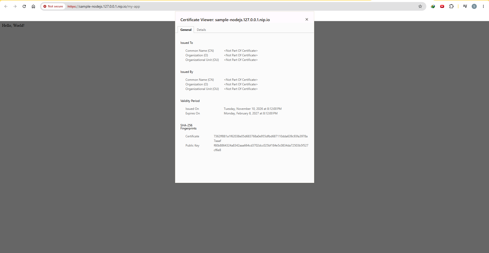
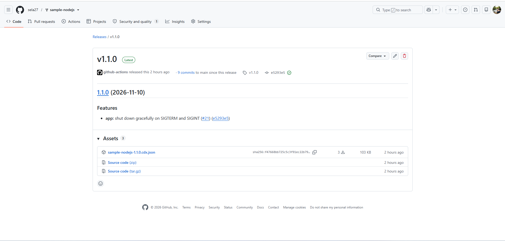
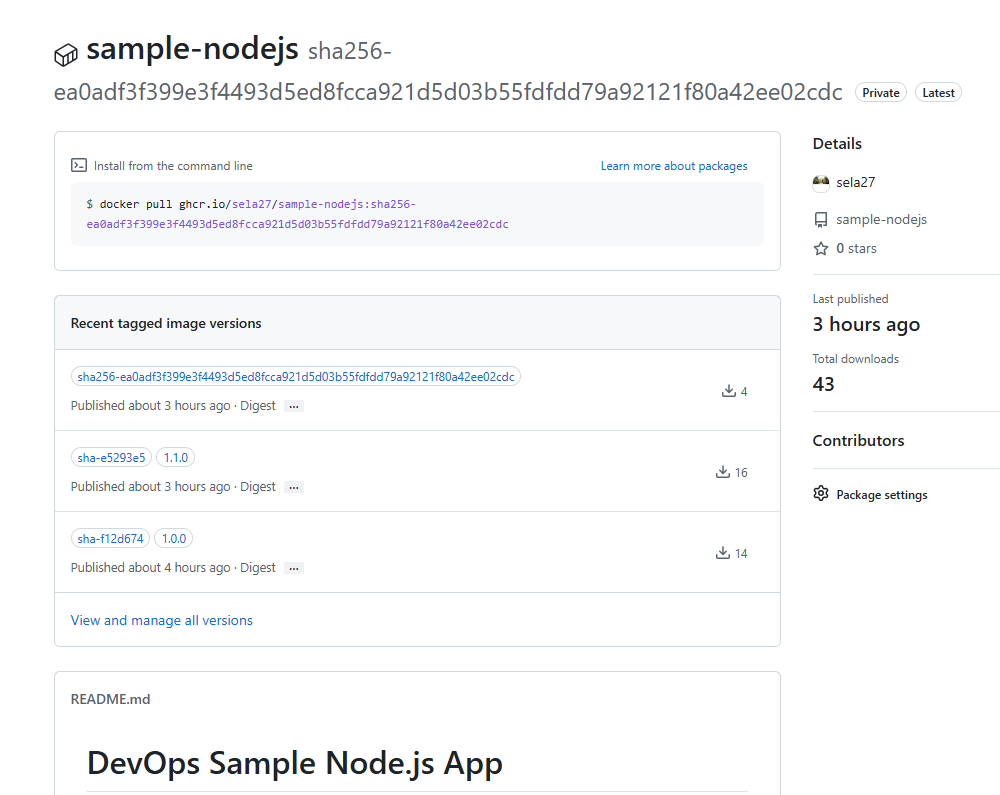
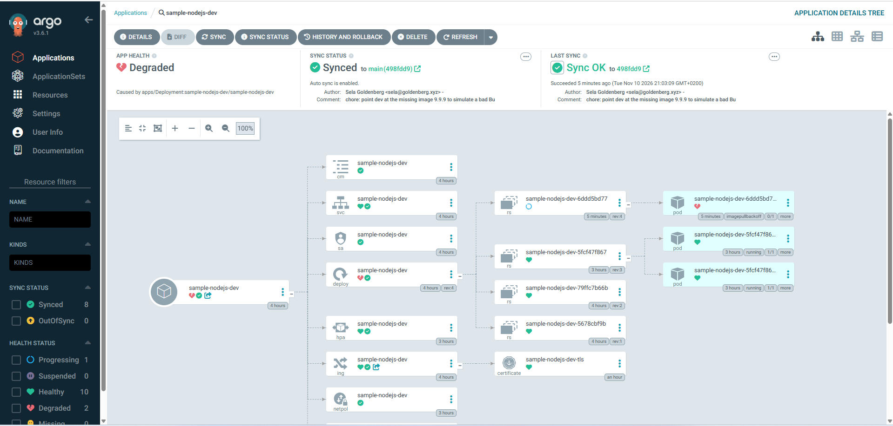
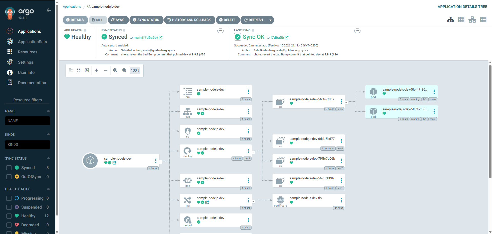

# DevOps Sample Node.js App

## Overview

A lightweight Node.js application. It features basic web endpoints, Prometheus metrics integration, and is designed for Kubernetes deployment and CI/CD pipeline demonstrations.

## Features

- Express.js web server
- Prometheus metrics integration
- Readiness and liveness probe endpoints
- Customizable port via environment variable
- Graceful shutdown on SIGTERM and SIGINT

## Prerequisites

- Node.js 24 (Active LTS)
- Docker, to build and run the container image

## Quick start

One command brings up a local cluster in which ArgoCD manages everything else from git, and Deploys the app to the `dev` Environment. You need Docker (Docker Desktop on Windows and macOS), minikube, kubectl and Helm. The script runs from Git Bash on Windows and from bash on Linux and macOS.

The image `ghcr.io/sela27/sample-nodejs` is a private package, so the cluster needs a token to pull it. Create a classic personal access token with only the `read:packages` scope (GitHub, Settings, Developer settings, Personal access tokens, Tokens (classic)). Then read it into `GHCR_PULL_TOKEN` without echo, so it stays out of your shell history, and run the script:

```bash
read -rs GHCR_PULL_TOKEN   # paste the token, then press Enter
export GHCR_PULL_TOKEN
scripts/bootstrap.sh
```

Without the token, the script stops at once with a message saying what to set, before it changes anything.

The script starts minikube with the Calico CNI (so NetworkPolicies are enforced) and the metrics-server addon, and installs ArgoCD from its pinned Helm chart. It creates the app namespace `sample-nodejs-dev` with the [restricted Pod Security](https://kubernetes.io/docs/concepts/security/pod-security-standards/#restricted) labels (`enforce`, `audit` and `warn`), and in it the registry pull secret `ghcr-pull` from the token. That secret is the one object in the cluster that does not come from git ([ADR-0003](docs/adr/0003-registry-pull-secret-created-at-bootstrap.md)). The script never prints the token, not even under `bash -x`, and passes it to kubectl on stdin, so it does not show in the process list either. Then it applies the root Application (`gitops/bootstrap/root-app.yaml`), and ArgoCD installs everything declared under `gitops/apps` on `main`:

- `traefik.yaml`: the Traefik ingress controller ([ADR-0002](docs/adr/0002-traefik-instead-of-minikube-ingress-addon.md)).
- `cert-manager.yaml`: cert-manager, from the official Jetstack chart, pinned at v1.21.3 (it ships cert-manager v1.21.3), with its CRDs. It issues the dev Ingress certificate.
- `cluster-issuer.yaml`: the self-signed `ClusterIssuer` (`selfsigned-issuer`, from `gitops/cluster-issuer`). It is its own Application because ArgoCD does not wait for a child Application to be healthy, and the ClusterIssuer needs cert-manager's CRD. The Application skips the dry run for the missing kind and retries with backoff until the CRD and the webhook are there, so a fresh Bootstrap converges with no manual step.
- `sample-nodejs-dev.yaml`: the app, from our chart with `values-dev.yaml`, in the `sample-nodejs-dev` namespace. It syncs automatically with prune and self-heal, so each [Bump commit](#bump-commit) on `main` is Deployed with no manual step.

The script waits until the app's Application is Synced and its pods pass the readiness probe. Re-running it is safe, because it reuses a running cluster, upgrades ArgoCD in place and updates the namespace and the pull secret in place. To rotate the token, re-run it with the new one. It ends by printing how to read the ArgoCD admin password, how to open the ArgoCD UI, and the app URL.

Then start the tunnel in a separate terminal and leave it running. It may ask for admin rights, because it binds ports 80 and 443 on localhost:

```bash
minikube tunnel
```

With the tunnel up, open the app in the browser at [http://sample-nodejs.127.0.0.1.nip.io/my-app](http://sample-nodejs.127.0.0.1.nip.io/my-app). It answers `Hello, World!`. The same path over HTTPS, [https://sample-nodejs.127.0.0.1.nip.io/my-app](https://sample-nodejs.127.0.0.1.nip.io/my-app), serves a self-signed certificate from cert-manager, so the browser shows a warning to click through (see [HTTPS](#https-lets-encrypt-in-production-self-signed-here)). Plain HTTP on port 80 keeps working; there is no redirect. Only the Public paths `/my-app` and `/about` have a route, so `/` and every other path get Traefik's own `404 page not found`. The tunnel also turns both Applications Healthy in ArgoCD. Until then they show Progressing: ArgoCD rates a LoadBalancer Service and an Ingress Progressing until they have an address, and the tunnel gives Traefik's Service one, which Traefik copies onto the app's Ingress.

`scripts/verify-bootstrap.sh` checks the whole setup and prints PASS, FAIL or SKIP for each check: the cluster, ArgoCD, Traefik, the namespace labels, the pull secret, the app's Application (source, sync policy, Synced, Healthy or waiting for the tunnel), that the app process runs as uid 1000, and `/my-app` through Traefik. The tunnel checks run only while the tunnel is up; the other HTTP checks go through a port-forward.

| Variable | Default | Purpose |
| --- | --- | --- |
| `GHCR_PULL_TOKEN` | none, required | Classic personal access token with only `read:packages`, stored as the pull secret `ghcr-pull` |
| `GHCR_PULL_USER` | `sela27` | GitHub user the token belongs to |
| `MINIKUBE_PROFILE` | `minikube` | minikube profile and kubectl context |
| `MINIKUBE_CPUS` | `4` | CPUs for the minikube node |
| `MINIKUBE_MEMORY` | `4096` | Memory for the minikube node, in MiB |
| `KUBERNETES_VERSION` | `v1.35.1` | Kubernetes version of the node |
| `ARGOCD_CHART_VERSION` | `10.17.0` (ArgoCD v3.6.1) | `argo/argo-cd` Helm chart version |
| `GIT_REPO_URL` | this repo | Repo the root Application follows |
| `GIT_REVISION` | `main` | Revision the root Application follows. Set it to a pushed branch to try child Applications before they merge, then re-run without it. |

The defaults fit Docker Desktop with about 6 GB of memory. minikube cannot resize an existing cluster, so a new CPU or memory value takes effect only after `minikube delete`. Traefik's version is pinned in `gitops/apps/traefik.yaml` (chart 42.3.1, Traefik v3.7.17).

## Verifying a Deploy

`scripts/smoke-test.sh` checks a Deploy from outside the cluster, the way a client reaches the app: through Traefik, with the Ingress host. It is the only end-to-end test. In one pass it covers the chart, Traefik, the Public path allowlist on the Ingress and the ArgoCD Deploy. Run it once ArgoCD shows `sample-nodejs-dev` Synced, for example after a [Bump commit](#bump-commit). It runs against the local cluster only, not in CI, because the pipeline never reaches the cluster.

| Path | Expected | Why |
| --- | --- | --- |
| `/my-app` | 200 and `Hello, World!` | Public path |
| `/about` | 200 | Public path |
| `/classified`, `/metrics`, `/ready` | 404 | Internal: the app serves them with 200, but the Ingress has no route for them, so Traefik answers its own 404 |

It prints PASS or FAIL for each path, with the status it got, and exits non-zero if any path fails. By default it goes through `minikube tunnel`. Without the tunnel, `--port-forward` makes the script port-forward the Traefik Service itself and send each request to that port with the `Host` header, so Traefik routes it exactly as it routes a request through the tunnel:

```bash
scripts/smoke-test.sh                  # through the tunnel, at http://sample-nodejs.127.0.0.1.nip.io
scripts/smoke-test.sh --port-forward   # without the tunnel, through a port-forward to Traefik
```

The dev Ingress also serves HTTPS, and the smoke test checks it too. With a `BASE_URL` that starts with `https://`, or `--port-forward --https` (which forwards Traefik's `websecure` port, 443), the script reads the CA from the certificate's secret, `sample-nodejs-dev-tls`, and verifies the certificate against it. The self-signed certificate is its own CA, so it sits in `ca.crt` of the secret (the script falls back to `tls.crt`). The requests go to `https://$APP_HOST` and are only routed to the address in `BASE_URL`, so the name checked is the Ingress host, not `127.0.0.1`:

```bash
BASE_URL=https://sample-nodejs.127.0.0.1.nip.io scripts/smoke-test.sh   # through the tunnel, certificate verified
scripts/smoke-test.sh --port-forward --https                            # without the tunnel, certificate verified
scripts/smoke-test.sh --port-forward --https --insecure                 # without verifying the certificate
```

`--insecure` skips the verification (`curl --insecure`). Use it only to see that the paths answer when no CA can be read: it also accepts a certificate from the wrong server, which the default does not. `CA_CERT` points at a CA file to trust instead of reading the secret.

```text
PASS  /my-app      200 "Hello, World!"
PASS  /about       200
PASS  /classified  404
PASS  /metrics     404
PASS  /ready       404

All paths passed.
```

A failure names the path, what it expected and what it got, for example `FAIL  /classified  expected 404, got 200` if the Ingress exposed an internal path. If nothing answers, the script says to start the tunnel or use `--port-forward`. On Windows, run it from Git Bash.

The same Deploy, checked by hand on 2026-11-10 with `minikube tunnel` running. A browser gets the app on a Public path, and Traefik's own 404 on an internal one:





ArgoCD shows `sample-nodejs-dev` Synced to `main` and Healthy, with every object the chart renders: ConfigMap, Service, ServiceAccount, Deployment and its ReplicaSets and pods, HPA, Ingress and its Certificate, NetworkPolicy and PodDisruptionBudget:



| Variable | Default | Purpose |
| --- | --- | --- |
| `APP_HOST` | `sample-nodejs.127.0.0.1.nip.io` | Ingress host of the Environment, sent as the `Host` header |
| `BASE_URL` | `http://$APP_HOST` | Scheme, host and port the requests go to, such as your own port-forward to Traefik. Not used with `--port-forward`. |
| `CA_CERT` | read from the secret | HTTPS only: file with the CA to trust |
| `TLS_NAMESPACE`, `TLS_SECRET` | `sample-nodejs-dev`, `sample-nodejs-dev-tls` | HTTPS only: the secret the CA is read from |
| `MINIKUBE_PROFILE` | `minikube` | kubectl context for `--port-forward` and for reading the secret |

## Running tests

```bash
npm ci
npm test
```

`npm test` runs Node's built-in test runner (`node --test`) over the `test/` directory. The tests drive the app through real HTTP requests, the same way a client does:

- `test/app.test.js` sends requests with supertest to the exported Express app in-process. It checks the status and body of `/my-app`, `/about`, `/ready`, `/live` and `/classified`, a 404 for an unknown path, and the `/metrics` contract: Prometheus content type, `root_access_total` present, and its value going up by one after a request to `/my-app`.
- `test/entrypoint.test.js` checks that loading `app.js` does not open a port, and that `node app.js` listens on `PORT` (default 8080) and prints `Server running on port <PORT>`. Its [graceful shutdown](#graceful-shutdown) tests start `node app.js` as a child process. They check that it exits 0 on SIGTERM and on SIGINT, that a request in flight when SIGTERM arrives still gets its answer while new connections are refused, and that `SHUTDOWN_TIMEOUT_MS` forces exit 1 when a request never finishes. Windows does not deliver POSIX signals to a child process, so these tests are skipped there. CI runs them on Linux.
- `test/bump-dev-image-tag.test.js` runs `scripts/bump-dev-image-tag.sh` with bash against a copy of the dev values ([Bump commit](#bump-commit)). On Windows, run `npm test` from Git Bash.

supertest is a dev dependency only; the app does not need it at runtime.

## Graceful shutdown

On SIGTERM, which Kubernetes and `docker stop` send, or SIGINT (Ctrl+C), `node app.js`:

1. Stops accepting new connections.
2. Lets requests already in flight finish. It answers them with `Connection: close`, so a keep-alive client such as the ingress controller's connection pool cannot hold the shutdown open.
3. Exits 0 once the server has closed.

If connections are still open after `SHUTDOWN_TIMEOUT_MS` milliseconds (default `10000`), the app logs that on stderr and exits 1. The kubelet sends SIGKILL when the pod's termination grace period runs out, so the timeout must stay shorter than that grace period minus any preStop pause. The chart sets the grace period to 30 seconds and pauses 5 seconds in a preStop hook, which leaves the app 25 seconds, 15 more than its default timeout. See [Zero-downtime rollouts](#zero-downtime-rollouts).

Before this, the container ignored SIGTERM altogether. Node runs as PID 1 in the container, and the kernel does not apply a signal's default action to PID 1, so a process without a handler never ends on SIGTERM. `docker stop` waited out its timeout and then killed it. Timed with `docker stop -t 10` on the hardened container from [Container image](#container-image) (Docker Desktop 29.6.1, 2026-11-10):

| Image | `docker stop` took | Exit code |
| --- | --- | --- |
| Before (no handler) | 10.66 s | 137 (SIGKILL) |
| Now | 0.58 s | 0 |

## Container image

```bash
docker build -t sample-nodejs .
docker run --rm -p 8080:8080 sample-nodejs
curl http://localhost:8080/my-app   # Hello, World!
```

To run it under the same constraints as the hardened pod in the cluster (read-only root filesystem, uid and gid 1000, no capabilities, no privilege escalation), add these flags. `/ready` and `/my-app` answer the same way:

```bash
docker run --rm -p 8080:8080 --read-only --user 1000:1000 \
  --cap-drop ALL --security-opt no-new-privileges sample-nodejs
```

The `Dockerfile` has two stages on the same base image:

- The **build stage** runs `npm ci --omit=dev --ignore-scripts`. It installs production dependencies only, exactly as `package-lock.json` pins them, and runs no install scripts.
- The **runtime stage** copies in only `app.js`, `package.json` and the production `node_modules`. It deletes npm, npx, corepack and yarn, sets `NODE_ENV=production`, runs as the image's built-in `node` user and exposes port 8080. The user is given by number, `USER 1000:1000`, so a runtime can check that it is not root from the image alone, without reading the image's `/etc/passwd`. The app files stay owned by root, so the app process cannot rewrite its own code.

The base image is pinned by its multi-arch digest, with the tag in a comment, so every build starts from the same bytes. Picking up base-image patches means bumping the digest, which [Dependabot](#dependabot) proposes every week.

`.dockerignore` is an allowlist. Only `app.js`, `package.json` and `package-lock.json` enter the build context. Tests, git metadata, docs, the tracker directory, CI and agent tooling, a local `node_modules` and any stray `.env` never reach the builder. A new source file has to be added there and to the `COPY` line.

### Why `node:24-alpine`

Node 24 is the Active LTS line. Before choosing a base, we scanned the candidates with Trivy 0.58.1 on 2026-11-08 and counted CRITICAL and HIGH findings:

| Base image | CRITICAL | HIGH |
| --- | --- | --- |
| `node:24-alpine` | 0 | 6 |
| `node:22-alpine` | 0 | 10 |
| `node:22-slim` (Debian) | 1 | 44 |
| distroless `nodejs22-debian12` | 1 | 6 |
| Chainguard `node:latest` | 0 | 0 |

Every Alpine finding was in the npm that the image bundles (its copies of `undici` and `brace-expansion`), not in Alpine itself. The app never runs npm, so the runtime stage deletes it. Without npm, `node:24-alpine` scans as clean as Chainguard, while staying an official Docker image with versioned tags on the LTS line. Chainguard's free tier publishes only `latest`, which follows the newest Node release rather than the LTS line. Alpine uses musl instead of glibc, which is fine here because both dependencies are plain JavaScript with no native modules.

A scan of the built image with the same Trivy version finds nothing in Alpine or in Node's tooling. The findings left were in the app's own locked dependencies, not in the base image. The [Image Gate](#image-gate) caught them and the lockfile update fixed them.

The image is about 65 MB compressed. The `node` binary is most of that, and the app's dependencies add about 10 MB.

## Helm chart

The chart lives in `gitops/charts/sample-nodejs/`, inside the `gitops/` directory that ArgoCD reads from this repo ([ADR-0001](docs/adr/0001-gitops-manifests-in-app-repo.md)).

```text
gitops/charts/sample-nodejs/
├── Chart.yaml
├── values.yaml         # chart defaults: everything that is the same in every Environment
├── values-dev.yaml     # the dev Environment: image and Ingress host
└── templates/
    ├── _helpers.tpl    # object name, labels, image reference, app configuration
    ├── configmap.yaml
    ├── deployment.yaml
    ├── hpa.yaml
    ├── pdb.yaml
    ├── serviceaccount.yaml
    ├── service.yaml
    ├── ingress.yaml
    ├── networkpolicy.yaml
    └── servicemonitor.yaml  # only with serviceMonitor.enabled
```

What it renders:

- **Deployment.** One container, listening on port `config.port` (8080), named `http`. Startup and liveness probes call `/live`, the readiness probe calls `/ready`. CPU and memory requests and limits come from `resources` in the values.
- **ConfigMap.** `PORT` (8080) and `NODE_ENV` (`production`) come from `config` in the values, through a ConfigMap that the container loads with `envFrom`. [Variables set in the pod spec override the image's own `ENV`](https://kubernetes.io/docs/tasks/inject-data-application/define-environment-variable-container/), so the ConfigMap's `NODE_ENV` wins over the one the Dockerfile sets. The container port is the same `config.port` value, and the probes and the Service reach the app through that port by name, so `PORT`, the container port and the probes cannot drift apart.
- **Rollout on a config change.** A container reads its environment variables only when it starts, so a changed ConfigMap alone would leave the running pods on the old values. The pod template carries a `checksum/config` annotation, the SHA-256 of the ConfigMap's data. A config change changes the checksum, and with it the pod template, so the Deployment rolls the pods. A change that leaves the ConfigMap as it is keeps the checksum and causes no rollout of its own.
- **Pod hardening.** The pods meet the [restricted Pod Security profile](https://kubernetes.io/docs/concepts/security/pod-security-standards/#restricted): `runAsNonRoot`, uid and gid 1000 (the image's `node` user), the `RuntimeDefault` seccomp profile, `allowPrivilegeEscalation: false` and every capability dropped. The root filesystem is read-only as well. The app writes nothing to disk, so it gets no writable volume, not even `/tmp`. These settings are written in the Deployment template, not taken from values, so no Environment's values file can loosen them.
- **HorizontalPodAutoscaler.** An `autoscaling/v2` HPA keeps the Deployment between 2 and 5 replicas, aiming at 70% average CPU use. All three numbers come from `autoscaling` in the values. Utilization is a share of the CPU request, so the 50m request makes the target 35m per pod. metrics-server, which Bootstrap enables, supplies the readings. While the HPA is on (`autoscaling.enabled`, the default), the Deployment leaves `replicas` out, so the HPA owns the count. If the Deployment set it, every ArgoCD sync would put the count from git back over the one the HPA chose. With the HPA off, `replicaCount` (2) sets the replicas.
- **Rollout settings.** A `RollingUpdate` with `maxUnavailable: 0` and `maxSurge: 1`, a 5-second native `sleep` preStop hook, `terminationGracePeriodSeconds: 30` and `progressDeadlineSeconds: 180`. They are written in the Deployment template, not taken from values. See [Zero-downtime rollouts](#zero-downtime-rollouts).
- **PodDisruptionBudget.** `minAvailable: 1` over the app's pods, from `podDisruptionBudget` in the values. A voluntary disruption, such as `kubectl drain`, can evict an app pod only while another one stays ready, so the app keeps serving through it. It does not cover a node or a pod crashing, only evictions. `minAvailable` stays below the fewest pods the Deployment runs (2), or no pod could ever be evicted and a drain would wait forever.
- **ServiceAccount.** The pods run under their own ServiceAccount, with `automountServiceAccountToken: false` on both the ServiceAccount and the pod, because the app never calls the Kubernetes API. The ServiceAccount carries the registry pull secret for the private image as its `imagePullSecrets` entry. The chart only names the secret (`image.pullSecret`, default `ghcr-pull`); Bootstrap creates it in the app namespace ([ADR-0003](docs/adr/0003-registry-pull-secret-created-at-bootstrap.md)).
- **Service.** `ClusterIP`, port 80 to the container's `http` port (8080). Nothing outside the cluster reaches it directly.
- **Ingress.** `ingressClassName: traefik` and no controller-specific annotations ([ADR-0002](docs/adr/0002-traefik-instead-of-minikube-ingress-addon.md)), so the controller can be replaced without a chart change. The host comes from the Environment's values. There is one `Prefix` rule per Public path, `/my-app` and `/about`, and nothing else. `/classified`, `/metrics`, `/ready` and `/live` have no route, so from outside the cluster they get the controller's 404.
- **Ingress TLS, off by default (on in dev).** `ingress.tls.enabled: true` gives the Ingress a TLS section for the host, naming the secret `<object name>-tls` (`sample-nodejs-dev-tls` in dev), and one annotation, `cert-manager.io/cluster-issuer`, set from `ingress.tls.clusterIssuer`. cert-manager sees the annotation, has that ClusterIssuer sign a certificate for the host, and keeps it in the secret, where Traefik picks it up. The annotation is read by cert-manager, not by the Ingress controller, so the Ingress still has no controller-specific annotations. With the flag on and no issuer set, the chart refuses to render. See [HTTPS: Let's Encrypt in production, self-signed here](#https-lets-encrypt-in-production-self-signed-here).
- **NetworkPolicy.** It selects the app's pods and admits traffic only on the container port (`http`, 8080), and only from Traefik's pods (`app.kubernetes.io/name: traefik`) in the `traefik` namespace, matched by the `kubernetes.io/metadata.name` label that Kubernetes sets on every namespace. Both selectors sit in one peer, so a pod must match both; as two peers they would admit any pod in the `traefik` namespace, or any pod with Traefik's labels in the app's namespace. Every other pod in the cluster, in any namespace including the app's own, cannot open a connection to the app, so `/classified` and `/metrics` stay out of its reach. The policy names the container port, not the Service's port 80, because it sees traffic after the Service has forwarded it to the pod. Egress is not restricted. The controller's namespace and pod labels come from `networkPolicy.ingressController` in the values. A NetworkPolicy is only enforced by a CNI plugin that implements it, which is why Bootstrap starts minikube with Calico. See [NetworkPolicy on the cluster](#networkpolicy-on-the-cluster).
- **ServiceMonitor, off by default.** `serviceMonitor.enabled: true` renders a `monitoring.coreos.com/v1` ServiceMonitor that scrapes `/metrics` on the Service's port `http`, every `serviceMonitor.interval` (30s), and adds the `monitoring` namespace (`networkPolicy.monitoring.namespace`) as a second peer of the NetworkPolicy, on the same container port. Off, the chart renders no ServiceMonitor and the NetworkPolicy admits only Traefik, so the cluster needs no monitoring CRDs. See [Turning monitoring on](#turning-monitoring-on).
- **Labels.** Every object and every pod carries `app.kubernetes.io/name`, `instance`, `version` (the image tag) and `managed-by`, plus Helm's `helm.sh/chart`. The Deployment selector uses only `name` and `instance`, which never change for a release, because a selector cannot be changed after creation.

### Why a Deployment, not a StatefulSet

The app keeps no data on disk, has no database, and needs no per-pod identity. Any pod can serve any request, and pods can be replaced in any order. The one piece of in-memory state, the `root_access_total` counter, is per pod by design: each pod reports its own count and Prometheus sums them, so losing a pod's count when the pod is replaced is expected, not data loss.

A StatefulSet gives stable pod names, ordered start and stop, and a PersistentVolumeClaim per pod. The app uses none of these, and the ordered, one-at-a-time rollout would only make every Deploy slower. A StatefulSet is the right choice for a database, a message broker, or anything that needs a stable network identity or its own volume.

### Zero-downtime rollouts

A rollout must never lower the number of ready pods and never cut a request short. The Deployment says so in five settings:

| Setting | Value | Why |
| --- | --- | --- |
| `strategy.rollingUpdate.maxUnavailable` | `0` | An old pod goes only after a new one is ready. |
| `strategy.rollingUpdate.maxSurge` | `1` | One extra pod at a time. |
| `lifecycle.preStop.sleep.seconds` | `5` | Kubernetes removes a terminating pod from the Service's endpoints and starts stopping it at the same moment, but Traefik hears of the removal a moment later. The pause keeps the app serving until Traefik has dropped it. The native `sleep` action (Kubernetes 1.30+) needs no shell in the image. |
| `terminationGracePeriodSeconds` | `30` | The grace period starts before the preStop hook, so it must cover the 5 s pause plus the app's shutdown timeout (`SHUTDOWN_TIMEOUT_MS`, 10 s). 30 s leaves 15 s to spare. |
| `progressDeadlineSeconds` | `180` | A rollout that makes no progress for 3 minutes, such as a new pod that never turns ready, is marked failed and ArgoCD shows the Deployment as Degraded, instead of after the default 10 minutes. An image pull plus the startup probe (30 s at most) fits well inside it. |

The old pods keep serving during the whole rollout, so a stuck rollout leaves the old version running.

**Checked on minikube** (2026-11-10), before merge, in a throwaway namespace, with the dev values (image tag `1.1.0`) under another Ingress host. `scripts/request-loop.js` sent 20 requests a second to `/my-app` through Traefik, each on a new connection, and counted every non-200 response and every connection error or timeout (5 s limit), while `kubectl rollout restart` ran four times in a row. The same test ran against the chart from `main` before this change:

| Chart | Rollouts | Requests | Non-200 | Errors | Each rollout took |
| --- | --- | --- | --- | --- | --- |
| `main`, before | 4 | 2,925 | 7 (HTTP 502) | 67 (timeouts) | 6 s |
| This branch | 4 | 2,922 | 0 | 0 | 6 s |

With the default strategy (25% unavailable, 25% surge) and no preStop pause, every rollout produced a burst of 502s and timeouts, as Traefik kept sending requests to a pod that had stopped listening. With the new settings the loop saw no failure in 2,922 requests.

To repeat it:

```bash
# 1. Install the chart in a throwaway namespace, under its own host.
kubectl create namespace zdt-check
helm install zdt gitops/charts/sample-nodejs -n zdt-check \
  -f gitops/charts/sample-nodejs/values-dev.yaml --set ingress.host=zdt.example.test
kubectl -n zdt-check rollout status deploy/zdt-sample-nodejs   # then wait until the HPA has made it two pods

# 2. Reach Traefik from the workstation.
kubectl -n traefik port-forward svc/traefik 18080:80 &

# 3. Start the loop; it prints one summary line when its duration ends.
node scripts/request-loop.js --url http://127.0.0.1:18080/my-app \
  --host zdt.example.test --rps 20 --duration 180 &

# 4. Roll the Deployment four times meanwhile.
for i in 1 2 3 4; do
  kubectl -n zdt-check rollout restart deploy/zdt-sample-nodejs
  kubectl -n zdt-check rollout status deploy/zdt-sample-nodejs
  sleep 5
done
wait   # prints: total=... ok=... non200=... errors=...

# 5. Clean up.
helm uninstall zdt -n zdt-check && kubectl delete namespace zdt-check
```

`scripts/request-loop.js` exits 1 if any request was not a 200 and logs each failure with a time stamp on stderr. The [Rollback](#rollback) demo reuses it.

### Autoscaling under load

Checked on minikube before merge, on a temporary copy of the dev Environment: an ArgoCD Application with the same chart and dev values, in a namespace of its own. At rest, metrics-server reads about 3m of CPU per pod, and the HPA holds the minimum of two:

```text
NAME                REFERENCE                      TARGETS       MINPODS   MAXPODS   REPLICAS
sample-nodejs-t21   Deployment/sample-nodejs-t21   cpu: 6%/70%   2         5         2
```

A load pod (the app image running a short Node script, eight keep-alive connections to the Service's `/my-app` for three minutes) sent about 4,400 requests a second, 792,434 in all, with no errors. On the next reading the HPA saw 288% of the request and scaled out to four pods, then 15 seconds later to five, its maximum:

```text
SuccessfulRescale   New size: 4; reason: cpu resource utilization (percentage of request) above target
SuccessfulRescale   New size: 5; reason: cpu resource utilization (percentage of request) above target

NAME                REFERENCE                      TARGETS         MINPODS   MAXPODS   REPLICAS
sample-nodejs-t21   Deployment/sample-nodejs-t21   cpu: 384%/70%   2         5         5
```

With five replicas running, a hard refresh left the Application `Synced`, the Deployment included, although its live `spec.replicas` was 5: git sets no count, so there is nothing for ArgoCD to put back. The Application's health stayed `Progressing` only because the Ingress has no address until `minikube tunnel` runs. The PodDisruptionBudget followed the count: `kubectl get pdb` showed 1 allowed disruption with two pods and 4 with five.

After the load stopped, the HPA waited out its default five-minute scale-down window, so that a short lull does not remove pods, then went to four and a minute later back to two. The Application was still `Synced`.

The two original pods kept the load (242m and 142m at the end) while the three new ones idled at 3m. The load pod went through the Service, and a keep-alive connection stays on the pod it was opened to, so new pods get only new connections. Through the Ingress this matters less: Traefik sends requests to the pods' endpoints itself and balances them per request. A load test that has to spread evenly over the Service needs short-lived connections or more clients.

### Values and Environments

- `values.yaml` holds everything that does not depend on the Environment: the app configuration (`config.port` and `config.nodeEnv`), the resources, the HPA (`autoscaling`) and the PodDisruptionBudget (`podDisruptionBudget`), the name of the registry pull secret, the Ingress class, the list of Public paths, the Ingress TLS flag, off, the Ingress controller that the NetworkPolicy admits (namespace `traefik`, pods labeled `app.kubernetes.io/name: traefik`), and the ServiceMonitor flag, off, with its scrape interval, its labels and the monitoring namespace the NetworkPolicy admits when it is on. An Environment that turns the flag on also sets its ClusterIssuer, because the issuer depends on the cluster.
- `values-dev.yaml` holds what the dev Environment adds: the image repository `ghcr.io/sela27/sample-nodejs`, the image tag, and the host `sample-nodejs.127.0.0.1.nip.io`. nip.io resolves that name to 127.0.0.1, where `minikube tunnel` exposes Traefik, so no hosts-file edit is needed.
- The chart refuses to render without an image repository, an image tag, a host and a pull secret name, or with Ingress TLS on and no ClusterIssuer, so a missing value fails at render time, not in the cluster.
- The dev image tag is a Release version, `1.0.0` at first, seeded by hand. From then on the [Bump commit](#bump-commit) is the only writer of `image.tag` in `values-dev.yaml`, and it always writes a Release version. No manifest uses `latest`.
- Adding an Environment means adding a `values-<environment>.yaml` and an ArgoCD Application for it, with no chart change.

Chart changes are `chore(chart)` commits, so they never produce a Release. They reach the cluster through ArgoCD, which renders the chart straight from git. For the same reason the chart's own `version` is never published or bumped; the version that matters is the image tag.

### HTTPS: Let's Encrypt in production, self-signed here

In production the ClusterIssuer would be a Let's Encrypt ACME issuer. Let's Encrypt certificates are free, every browser trusts them, and cert-manager renews them before they expire. The chart would not change: the production values file would turn the flag on and name that issuer.

Let's Encrypt only signs for a name once it has checked, from the internet, that the requester controls it: either it fetches a token over HTTP on port 80 of the host (HTTP-01), or it reads a TXT record in the domain's DNS (DNS-01). Neither works for this local setup. `sample-nodejs.127.0.0.1.nip.io` resolves to 127.0.0.1, the loopback address of whichever machine asks, so Let's Encrypt's servers would reach themselves, not this cluster. And the DNS zone belongs to nip.io, so we cannot add a TXT record to it.

So the local setup uses a self-signed ClusterIssuer: cert-manager signs the certificate itself, with no outside party involved. The traffic is encrypted all the same, but no trusted CA vouches for the certificate, so the browser shows a warning.

The flag is on in `values-dev.yaml`, with `clusterIssuer: selfsigned-issuer`. Bootstrap brings cert-manager and the issuer (two child Applications, see [Quick start](#quick-start)), so the Ingress's `cert-manager.io/cluster-issuer` annotation makes cert-manager create a Certificate for `sample-nodejs.127.0.0.1.nip.io` and store it in the secret `sample-nodejs-dev-tls`, which Traefik serves on its `websecure` entrypoint (port 443). The route is the same on both entrypoints, so HTTP on port 80 still works and nothing redirects it. The NetworkPolicy needs no change: Traefik terminates TLS and talks to the pod on 8080 as before.

Verifying it against a running cluster:

```bash
kubectl -n sample-nodejs-dev get certificate        # READY is True
scripts/smoke-test.sh --port-forward --https        # the certificate is verified against the secret's CA
```

**Checked on minikube** (2026-11-10), after the merge of the PR that added this. ArgoCD synced `cert-manager` and `cluster-issuer` from a hard refresh of `root`, with no manual step; the ClusterIssuer `selfsigned-issuer` and the Certificate `sample-nodejs-dev-tls` were Ready within seconds of the pods starting, and the secret's `ca.crt` is filled (the self-signed certificate itself). The smoke test passed with the CA verified, not `--insecure`, in all four ways to reach the app: `BASE_URL=https://sample-nodejs.127.0.0.1.nip.io` through `minikube tunnel`, plain HTTP through the tunnel, `--port-forward --https` and `--port-forward`. With a CA that did not sign the certificate (a throwaway one in `CA_CERT`), the HTTPS run got no response, so the check does reject a wrong certificate. `scripts/verify-bootstrap.sh` passed all its checks.

| | Before | After cert-manager |
| --- | --- | --- |
| minikube container memory (`docker stats`) | about 2.6 GiB of 4 GiB | 2.89 GiB of 4 GiB |
| cert-manager pods (`kubectl top`) | n/a | controller 27 Mi, cainjector 29 Mi, webhook 12 Mi |

In the browser, `https://sample-nodejs.127.0.0.1.nip.io/my-app` serves the app with the expected warning, because no trusted CA signed the certificate. The certificate is cert-manager's: issued 2026-11-10 for the Ingress host, valid for 90 days, with no subject or issuer name of its own (the host is in the subject alternative names):



### Turning monitoring on

The app serves Prometheus text on `/metrics`, including `root_access_total`. The Ingress does not route that path, so Prometheus has to reach the Service from inside the cluster, and the NetworkPolicy has to let it in. One flag does both:

1. Install a Prometheus Operator that provides the `ServiceMonitor` CRD, such as kube-prometheus-stack. The flag stays off until the CRD exists, because a ServiceMonitor cannot be applied without it.
2. In the Environment's values file, set:

   ```yaml
   serviceMonitor:
     enabled: true
     labels:
       release: kube-prometheus-stack   # the label that Prometheus's serviceMonitorSelector matches
   networkPolicy:
     monitoring:
       namespace: monitoring            # the namespace Prometheus runs in
   ```

   `serviceMonitor.interval` (default `30s`) sets the scrape interval. `serviceMonitor.labels` is empty by default, and Prometheus ignores a ServiceMonitor its selector does not match: kube-prometheus-stack selects on its Helm release name by default, so the label's value is the name of that release.
3. Merge it. ArgoCD syncs the ServiceMonitor and the wider NetworkPolicy together. The ServiceMonitor selects the Service by the chart's name and instance labels, in its own namespace, so it scrapes only this release.

The NetworkPolicy admits every pod in the monitoring namespace, matched by the `kubernetes.io/metadata.name` label, not only the Prometheus pod: the pod's labels depend on how Prometheus was installed. Nothing but monitoring should run in that namespace.

### Chart check

`scripts/check-chart.sh` is the `chart` check, and runs the same way locally and in CI:

1. `helm lint --strict` with the dev values (TLS on), and again with Ingress TLS off and with TLS on and another issuer. Warnings fail too.
2. `helm template` with the dev values, and again with Ingress TLS off and with TLS on and a test ClusterIssuer name. A render with TLS on and no issuer must fail.
3. kubeconform in strict mode, over the four renders (dev, TLS off, TLS on with another issuer, ServiceMonitor on), against the schemas of Kubernetes 1.35.1, the version Bootstrap runs. Strict mode also rejects unknown fields, such as a misspelled `containerPorts`, and duplicate keys, which Kubernetes would otherwise drop without a word.
4. Assertions on the rendered manifests. The expected values come from the spec, not from the chart, so a chart edit cannot quietly move them: the Ingress serves exactly the Public paths, with class `traefik` and the dev host (and, with TLS off, no annotations and no TLS section); the probes call `/live` and `/ready` on the container port; the container listens on 8080; the Service is `ClusterIP`, maps 80 to 8080 and selects the app's pods; the Ingress points at that Service; the image is `ghcr.io/sela27/sample-nodejs` with a fixed tag, never `latest`; the pod hardening holds (non-root as uid and gid 1000, `RuntimeDefault` seccomp, read-only root filesystem, no privilege escalation, all capabilities dropped and none added); the pods run under the chart's ServiceAccount, mount no API token and get the `ghcr-pull` secret; an `autoscaling/v2` HPA scales that Deployment between 2 and 5 replicas on CPU alone at 70% utilization, every container it scales has a CPU request, and the Deployment sets no `replicas`; a PodDisruptionBudget with `minAvailable: 1` selects the app's pods and stays below the HPA's minimum, so a drain can still evict a pod; `PORT` (8080) and `NODE_ENV` (`production`) reach the app from the ConfigMap, and the pod template carries the `checksum/config` annotation; one NetworkPolicy selects the app's pods, restricts ingress only, admits one TCP port, the container port, and admits exactly one peer, Traefik's pods in the namespace that `gitops/apps/traefik.yaml` deploys Traefik into; the Deployment rolls with `maxUnavailable: 0` and `maxSurge: 1`, pauses in a native `sleep` preStop hook, has a termination grace period longer than that pause plus the app's 10-second shutdown timeout, and a progress deadline of at most 300 seconds; and every object and pod has the standard labels. A security setting may sit on the pod or on the container; the check reads the value the kubelet applies, the container's own if set, else the pod's. An environment variable is resolved the same way: an `env` entry wins over `envFrom`, a later `envFrom` source over an earlier one, and both over the image's `ENV`. So an `env` entry that shadows the ConfigMap fails the check, as does a reference to a ConfigMap the chart does not render.
5. Assertions on TLS. The dev render has one TLS entry, for the dev host, naming the secret `sample-nodejs-dev-tls`, and its only annotation is `cert-manager.io/cluster-issuer: selfsigned-issuer`. The render with TLS on and another issuer has the same shape with the issuer the check passed in; and with the TLS section and the annotation taken out, it is the TLS-off render, object for object, so the flag changes nothing else.
6. Assertions on the ServiceMonitor-on render, with a scrape interval, a label and a namespace that differ from the defaults, so the values show up in the objects: one `monitoring.coreos.com/v1` ServiceMonitor with one endpoint, path `/metrics`, on the Service's port name, with that interval and label, selecting the Service by its labels and pinning the release; the NetworkPolicy has two peers, Traefik's first and unchanged, then the monitoring namespace, on the one container port; and with the ServiceMonitor and that peer taken out, the render is the default one, object for object. The default render has no ServiceMonitor and one peer. The default values give `30s` and the `monitoring` namespace.
7. Renders with one value changed, to check what a values change does. Another `config.nodeEnv` reaches the app over the image's `NODE_ENV` and changes the checksum. Another `config.port` moves `PORT`, the container port, the probes, the Service's target and the NetworkPolicy's port together, and changes the checksum. A change outside the ConfigMap, such as `replicaCount` with the HPA off, keeps the checksum. Other `autoscaling` numbers reach the HPA. With the HPA off there is no HPA, the Deployment's `replicas` is `replicaCount`, and the default `replicaCount` still leaves the PodDisruptionBudget room to evict a pod.

Each failure prints what was expected and what the chart rendered. If the dev values added `/classified` to the Public paths, for example, the check fails with `expected: /about /my-app | got: /about /classified /my-app`.

## Pipeline

Every pull request to `main` runs these checks, defined in `.github/workflows/pr.yml`:

| Check | What it runs | Fails when |
| --- | --- | --- |
| `test` | `npm ci --ignore-scripts`, then `npm test`, on Node 24 | any test fails |
| `dockerfile-lint` | hadolint 2.15.1 on `Dockerfile` | any finding of severity warning or error (info and style findings are printed but pass) |
| `chart` | `scripts/check-chart.sh`: helm 4.1.4 lint, render with the dev values, kubeconform 0.8.0 strict against Kubernetes 1.35.1, then assertions on the rendered manifests with yq 4.54.1 | a lint warning or error, a schema violation, or a rendered manifest that breaks the chart's contract, such as an Ingress path that is not a Public path |
| `secrets` | gitleaks 8.30.1 with its default rules over every commit the PR brings, the ones reachable from the PR head but not from `main`, with full history fetched | any finding, including a secret added in one commit and removed in a later one, because it stays in the PR's history on GitHub |
| `image-gate` | builds the image with BuildKit and keeps it on the runner, then scans it with Trivy 0.76.2 ([Image Gate](#image-gate)) | any HIGH or CRITICAL vulnerability, including one with no fixed version yet, that `.trivyignore` does not list |
| `iac-gate` | `scripts/check-iac.sh`: Trivy 0.76.2's misconfiguration checks over the `Dockerfile` and the chart rendered by helm 4.1.4 with the dev values ([IaC Gate](#iac-gate)) | any HIGH or CRITICAL misconfiguration that `.trivyignore` does not list, such as a container without a read-only root filesystem |

Each check is its own job, so a failure shows as its own red check on the PR. The check names are a contract with the [branch protection](#branch-protection) on `main`, which requires them by name. No job sets `name:`, so GitHub names each check after its job id. The PR page shows `PR / test (pull_request)`, but the name the ruleset matches is the bare job id, `test`. A job id therefore never changes unless the ruleset changes in the same PR. New Gates are added as new jobs at the end of the workflow, as new rows in this table, and as required checks in `scripts/protect-main.sh`.

To run the same checks locally:

```bash
npm ci && npm test
docker run --rm -i ghcr.io/hadolint/hadolint:v2.15.1 hadolint --failure-threshold warning - < Dockerfile
scripts/check-chart.sh   # needs helm 4, kubeconform and yq 4 on PATH
gitleaks git --redact --verbose --log-opts="origin/main..HEAD"   # needs gitleaks 8 on PATH
docker build -t sample-nodejs:local . && trivy image --image-src docker --scanners vuln \
  --severity HIGH,CRITICAL --ignorefile .trivyignore --exit-code 1 sample-nodejs:local   # needs trivy 0.76.2
scripts/check-iac.sh     # needs helm 4 and trivy 0.76.2 on PATH
```

### Image Gate

`image-gate` builds the image the way a Release will, and blocks the PR while that image carries a known HIGH or CRITICAL vulnerability.

1. `docker buildx build --load` builds the image with BuildKit and loads it into the runner's Docker engine. Nothing is pushed and no step logs in to a registry, so on a PR the image never leaves the runner.
2. Trivy scans that local image (`--image-src docker`, so it never pulls an image from a registry): the Alpine packages and the app's production dependencies in `node_modules`.
3. Any HIGH or CRITICAL finding fails the check, including one that has no fixed version yet, because `--ignore-unfixed` is deliberately not set. The findings table is printed in the job log.

**It caught real vulnerabilities on its first run.** [PR #10](https://github.com/sela27/sample-nodejs/pull/10) added the Gate in a commit of its own, and the check went red on the dependencies the sample app had locked:

| Package | Severity | Installed | Fixed | Vulnerability |
| --- | --- | --- | --- | --- |
| `proxy-addr` | CRITICAL | 2.0.7 | 2.0.8 | CVE-2026-90711: IP spoofing via an IPv4-mapped IPv6 trust subnet |
| `body-parser` | HIGH | 1.20.3 | 1.20.9 | CVE-2026-111181: denial of service via an unhandled decompression stream error |
| `path-to-regexp` | HIGH | 0.1.12 | 0.1.13 | CVE-2026-4867: denial of service via catastrophic backtracking on malformed URL parameters |

All three are transitive dependencies of Express 4.21.2. Alpine 3.24.4 had no findings, because the runtime stage already drops npm. `npm audit` also marks `express` itself as high, only because it depends on these packages; Trivy reports the packages that carry the advisories.

The ruleset already required `image-gate` at that point, so the PR could not merge. The screenshot shows `PR / image-gate` failing and marked Required, the other four checks green and Required, and "Squash and merge" disabled:


A second commit in the same PR ran `npm audit fix --ignore-scripts`. It updated `package-lock.json` inside the ranges `package.json` already allowed, and left `package.json` unchanged:

| Package | Before | After |
| --- | --- | --- |
| `express` | 4.21.2 | 4.22.3 |
| `body-parser` | 1.20.3 | 1.20.9 |
| `path-to-regexp` | 0.1.12 | 0.1.13 |
| `proxy-addr` | 2.0.7 | 2.0.8 |
| `qs` (moderate findings only) | 6.13.0 | 6.16.2 |
| `raw-body` | 2.5.2 | 2.5.3 |

Express stays on 4.x, `npm audit` reports 0 vulnerabilities, the tests pass, and `image-gate` went green with the other four checks. The fix could not come in a separate PR from `main`: that PR would not contain the Gate, which existed only on this unmerged branch, so it could never pass the required check. The PR is titled `fix(deps): …`, so its squash commit is the fix that drives the first Release.

**Why Trivy is a pinned binary, not the action.** The tags of `aquasecurity/trivy-action` and `setup-trivy` were hijacked on 2026-03-19 (CVE-2026-33634), and Trivy 0.69.4 and the Docker Hub images 0.69.5 and 0.69.6 were malicious ([GHSA-69fq-xp46-6x23](https://github.com/aquasecurity/trivy/security/advisories/GHSA-69fq-xp46-6x23)). The job therefore uses neither action. It downloads the Trivy 0.76.2 release file with `gh release download` and checks it against a pinned SHA-256 before it runs, the same way as the `chart` job's tools. 0.76.2 was chosen because:

- it is outside the compromised 0.69.4–0.69.6, and newer than every fix in Trivy's published advisories (the latest is 0.72.0, on 2026-06-30);
- it is a GitHub immutable release, so its files cannot be replaced after publication. `gh release verify v0.76.2 -R aquasecurity/trivy` checks the release attestation, and `cosign verify-blob` confirms that `trivy_0.76.2_checksums.txt` was signed by Trivy's own release workflow at tag `v0.76.2`. That file lists the pinned SHA-256;
- it is the current patch release, with the 0.76.2 security fixes in Trivy's own dependencies.

Like the other tools hosted on GitHub releases, the file is fetched through the GitHub API with the job's read-only token, not from the anonymous `github.com/.../releases/download` URL. That URL returned 504 during a GitHub incident on 2026-11-09 and failed this PR's first run, while the API kept serving the same file.

**The ignore file.** `.trivyignore` lists the vulnerability IDs the Gate accepts, and it is empty. The [IaC Gate](#iac-gate) reads the same file, under the same rules. Fixing means a dependency or base-image update, not an entry there. An entry is allowed only for a finding that cannot be fixed yet, with a comment directly above it giving both the justification (why it cannot be fixed now, for example no fixed version exists) and the reason it is safe (why the vulnerable code cannot be reached or exploited in this image). An entry without both is not merged, and the PR that ships the fix removes the entry.

### IaC Gate

`iac-gate` runs `scripts/check-iac.sh`, and blocks the PR while the `Dockerfile` or the chart carries a HIGH or CRITICAL misconfiguration. The script runs the same way locally and in CI:

1. helm renders the chart with the dev values and the dev release name, as ArgoCD does for `dev`. Trivy scans these rendered manifests, not the raw templates, so each finding is about an object that would be applied, with the values filled in, and names that object.
2. `trivy config` runs its Dockerfile and Kubernetes checks over the `Dockerfile` and the rendered manifests, in one run.
3. Any HIGH or CRITICAL finding fails the check, unless `.trivyignore` lists it with a justification. The findings are printed in the job log.

The `chart` check asserts the settings this chart promises. The IaC Gate adds Trivy's general rules, which also cover what the chart check does not name, such as a privileged container, the host's network or an image that runs as root.

**The checks are pinned with the binary.** By default, Trivy fetches the latest bundle of its checks from a container registry (`mirror.gcr.io/aquasec/trivy-checks`) and keeps it in its cache. The script passes `--skip-check-update` and an empty cache directory of its own, so Trivy uses the checks embedded in the 0.76.2 binary, never a bundle that an earlier run left in the cache. The checks are then pinned by the binary's version and SHA-256, the scan makes no download that could flake, and a local run applies exactly the checks CI applies. New checks arrive with a Trivy upgrade, in a PR of their own, instead of turning an unrelated PR red. Trivy logs `Falling back to embedded checks` at ERROR level on every run; that is this intended path, not a failure. The job's only downloads are helm and Trivy, with retries and through the GitHub API, as in the other jobs.

**It fails when the hardening goes.** Checked locally, without committing: with `readOnlyRootFilesystem: true` deleted from the Deployment template, `scripts/check-iac.sh` exits 1 with:

```text
sample-nodejs-dev.yaml (kubernetes)
Failures: 1 (HIGH: 1, CRITICAL: 0)
KSV-0014 (HIGH): Container 'app' of Deployment 'sample-nodejs-dev' should set 'securityContext.readOnlyRootFilesystem' to true
```

**The current repo passes**: no HIGH or CRITICAL finding, so nothing needed a fix and `.trivyignore` has no entry for this Gate. The scan's lower findings do not fail the check and are not printed. They are, in Trivy 0.76.2:

| Check | Severity | Finding | Why it stays |
| --- | --- | --- | --- |
| `DS-0026` | LOW | No `HEALTHCHECK` in the `Dockerfile` | Kubernetes ignores the image's `HEALTHCHECK` and runs its own probes on `/live` and `/ready`. |
| `KSV-0020`, `KSV-0021` | LOW | uid and gid not above 10000 | The pod runs as the image's `node` user, uid and gid 1000, as non-root, with every capability dropped and no privilege escalation. |
| `KSV-01010` | MEDIUM | "Sensitive content" in the ConfigMap | A false positive on the key name `PORT`. The ConfigMap holds only `PORT` and `NODE_ENV`. |
| `KSV-0110` | LOW | Workloads in the `default` namespace | The rendered manifests name no namespace. ArgoCD applies them into the dev Environment's own namespace. |
| `KSV-0125` | MEDIUM | Image from an untrusted registry | `ghcr.io` is not on Trivy's built-in list of trusted registries. It is this repo's own registry. |

### Supply chain and permissions

- Every third-party action is pinned by full commit SHA, with the version in a trailing comment, for example `actions/checkout@3d3c42e5aac5ba805825da76410c181273ba90b1 # v7.0.1`. A tag can be moved to other code, a commit SHA cannot. The tags of `aquasecurity/trivy-action` and `setup-trivy` were hijacked on 2026-03-19 (CVE-2026-33634), and only workflows pinned by SHA were safe from the swap. The SHAs come from the actions' release tags through `gh api repos/<owner>/<repo>/git/ref/tags/<tag>`, with annotated tags dereferenced to their commit.
- The hadolint action pins its own hadolint image by digest, so pinning the action also fixes the linter version.
- Tools that do not come as actions (helm, kubeconform and yq in the `chart` job, gitleaks in the `secrets` job, Trivy in `image-gate`, helm and Trivy in `iac-gate`, Trivy and cosign in the release `image` job) are downloaded at a pinned version and checked against a pinned SHA-256 before they run. The runner's preinstalled helm and yq are not used.
- gitleaks prints its findings redacted, so the job log of this public repo does not repeat a leaked value.
- Each workflow's default token permission is `contents: read` and nothing else. A job that needs more asks for it in its own `permissions:` block. Only the release workflow does, as listed in [Release flow](#release-flow).
- `actions/checkout` runs with `persist-credentials: false`, so the token is not left in the git config for later steps. The one exception is the release `bump` job, which keeps its deploy key configured for its own push. No other action runs in that job, and checkout's post step removes the key.
- `npm ci --ignore-scripts` keeps dependency install scripts from running on the runner, the same as in the image build.
- A new push to a PR cancels that PR's run still in progress. A release run is never cancelled.

**An SBOM on every Release.** Each GitHub Release carries `sample-nodejs-<version>.cdx.json`, a CycloneDX JSON SBOM (software bill of materials) of the image it released. It lists every package in the image, the Alpine packages and the app's npm dependencies, each with its version and package URL. The release run makes it like this:

1. After the push, the `image` job reads the digest of `ghcr.io/sela27/sample-nodejs:<version>` back from GHCR with `docker buildx imagetools inspect`, so it is the digest the registry serves, not one taken from the runner's Docker engine.
2. The same pinned Trivy 0.76.2 as the image Gate reads the image at that digest from GHCR (`--image-src remote`, not the local copy) and writes the SBOM (`--format cyclonedx`). The SBOM therefore describes exactly the image the cluster pulls. It names that digest in its metadata, in the `aquasecurity:trivy:RepoDigest` property, and the job fails if the SBOM has no components or names another image.
3. The file goes to the `release` job as a workflow artifact, and `@semantic-release/github` uploads it to the GitHub Release, through the `assets` entry in `.releaserc.yaml`. The plugin only logs a warning when an asset file is missing, and still creates the Release, so the job then downloads the asset back from the Release and compares it byte for byte with the file it uploaded. A Release without its SBOM turns the run red.

Trivy makes the SBOM rather than a second tool such as Syft because it is already in the job, pinned and checked against its SHA-256, so there is nothing new to pin or trust. The SBOM holds the inventory only, no vulnerabilities: a vulnerability list would be out of date within days. Instead, the SBOM lets anyone scan a released image again against today's vulnerability database without pulling it from the private package. To check the SBOM of a Release (`v1.0.0` predates the SBOM and has none):

```bash
v=1.1.0
gh release download "v$v" --repo sela27/sample-nodejs --pattern "sample-nodejs-$v.cdx.json"
docker run --rm -v "$PWD:/sbom:ro" cyclonedx/cyclonedx-cli:0.33.1 \
  validate --input-file "/sbom/sample-nodejs-$v.cdx.json" --input-format json --fail-on-errors
jq -r '.metadata.component.properties[] | select(.name == "aquasecurity:trivy:RepoDigest").value' "sample-nodejs-$v.cdx.json"
trivy sbom --severity HIGH,CRITICAL "sample-nodejs-$v.cdx.json"   # the image's vulnerabilities as of today
```

The `v1.1.0` Release, with the SBOM among its assets:



### Dependabot

`.github/dependabot.yml` has Dependabot look for version updates once a week, on Monday, wherever this repo pins a dependency. Its PRs are ordinary PRs to `main`: they run every required check and merge only when all of them pass, so an update that breaks a test, the chart or the image Gate cannot land.

| What it updates | Directory | PRs | Title prefix | Release on merge |
| --- | --- | --- | --- | --- |
| The app's production npm dependencies (`dependencies` in `package.json`, and the packages below them in `package-lock.json`) | `/` | minor and patch updates together in the `production` group; each major in its own PR, except Express, which stays on 4 | `fix(deps)` | patch |
| The app's dev npm dependencies (`devDependencies`) | `/` | all together in the `development` group | `chore(deps)` | none |
| The release tooling (`release/package.json` and `release/package-lock.json`) | `/release` | minor and patch updates together in the `release-tooling` group | `ci(deps)` | none |
| The base image (`FROM node:24-alpine@sha256:…` in the `Dockerfile`) | `/` | one PR with the new digest, staying on Node 24 | `chore(deps)` | none |
| The actions in `.github/workflows/*.yml` | `/` | all together in the `actions` group | `ci(deps)` | none |

- **The prefix decides the Release.** The squash commit on `main` is the PR title, and Dependabot starts its titles with the configured prefix and a colon, as in `fix(deps): bump the production group with 2 updates`, `fix(deps): bump express from 4.22.3 to 4.22.4 in the production group` or `ci(deps): bump the actions group with 2 updates`. A security update adds `[security]` after the prefix, as in `fix(deps): [security] bump …`, which the commit analyzer still reads by its type. Only the app's production dependencies, the code the image runs, use the releasing `fix`. No entry sets `include: scope`, which would append a second scope to the prefix, as in `fix(deps)(deps)`.
- **One dependency type per group.** A grouped PR takes the production prefix as soon as one production dependency is in it, so a mixed group would release dev-only changes. The app's two groups are therefore split by dependency type.
- **A base-image update does not release by itself.** It merges as `chore(deps)`, so the patched base reaches GHCR with the next `fix` or `feat`. To ship a base-image security fix at once, retitle the Dependabot PR to `fix(deps): …` before merging it.
- **Version comments stay in step.** Dependabot moves an action's SHA and its trailing version comment together. GitHub's docs say "Dependabot updates the version documentation of GitHub Actions when the comment is on the same line" ([supported ecosystems](https://docs.github.com/en/code-security/dependabot/ecosystems-supported-by-dependabot/supported-ecosystems-and-repositories#github-actions)), which is how every action here is pinned.
- **Majors held back.** Major updates of Express (the spec keeps Express 4), of the base image (Node 24 is the chosen LTS line, see [Why `node:24-alpine`](#why-node24-alpine)) and of the release tooling are ignored. The release tooling's majors are a manual step: the preset's majors follow the release notes writer that semantic-release bundles (see "Pinned release tooling" in [Release flow](#release-flow)), and no PR check runs the release tooling, so a broken update would first show as a red `version` job on `main`. These rules hold back version updates only. Dependabot drops `update-types` ignore rules when it looks for a security fix ([`ignore_condition.rb`](https://github.com/dependabot/dependabot-core/blob/main/common/lib/dependabot/config/ignore_condition.rb)).
- **Security updates** are a repo setting, separate from the file. When an advisory affects a locked version, Dependabot opens a fix PR without waiting for the schedule, with the same prefixes as the matching entry above. They need Dependabot alerts, and both are turned on by a repo admin:

  ```bash
  gh api -X PUT repos/sela27/sample-nodejs/vulnerability-alerts
  gh api -X PUT repos/sela27/sample-nodejs/automated-security-fixes
  ```

- **Secrets.** A workflow run that Dependabot triggers gets a read-only token and only the repo's Dependabot secrets, never its Actions secrets. The current checks need none. A check that does needs its secret added under both, which is why `SONAR_TOKEN` also goes in as a Dependabot secret when the SAST Gate arrives.
- **Not covered.** Dependabot does not read the versions pinned with a SHA-256 in the workflows (helm, kubeconform, yq, gitleaks, Trivy, cosign), the Traefik and ArgoCD chart versions, or the tool versions in the README. Those are bumped by hand.

`scripts/check-dependabot.sh` validates the file before it lands, because GitHub reads it only from `main` and a mistake would show up as update PRs that never arrive. It checks the file against the Dependabot configuration schema with check-jsonschema 0.39.0, then against the policy above: the four entries, the weekly schedule, the prefix of each entry, no `include: scope`, and one dependency type per group of the app's updates. It needs [uv](https://docs.astral.sh/uv/) on PATH and prints PASS or FAIL per check:

```bash
scripts/check-dependabot.sh                    # checks .github/dependabot.yml
scripts/check-dependabot.sh path/to/other.yml  # or another file
```

## Release flow

A squash merge into `main` becomes one commit, and its message is the PR title, a Conventional Commit. That commit type alone decides whether the merge produces a Release. `.github/workflows/release.yml` runs on every push to `main` and never on a pull request.

| Commit type | Release |
| --- | --- |
| `feat` | minor, for example 1.2.0 to 1.3.0 |
| `fix`, `perf`, or a revert | patch, for example 1.2.0 to 1.2.1 |
| any type with a breaking change (`feat!:` or a `BREAKING CHANGE:` footer) | major, for example 1.2.0 to 2.0.0 |
| `ci`, `docs`, `chore`, `build`, `test`, `refactor`, `style` | none |

The first Release is 1.0.0, whatever the type. Only changes to the app or its production dependencies use `feat` or `fix`. Chart, cluster, CI, build, test and docs changes use the other types, so they never ship a new image.

The run has four jobs. Each one starts only if the one before it succeeded:

1. **`version`** runs semantic-release in dry-run mode (`release/next-version.mjs`). It reads the commits since the last `v*` tag, logs a verdict for each commit and the release notes it would publish, and creates nothing. If no commit warrants a Release, it logs `No Release from this commit`, and the run ends there, green, with the other three jobs skipped.
2. **`image`** builds the image with BuildKit, tagged with the version and with `sha-<short commit>`. It then runs the image Gate on it, with the same pinned Trivy 0.76.2, flags and `.trivyignore` as the `image-gate` PR check. Only then does it log in to GHCR and push both tags to the private package `ghcr.io/sela27/sample-nodejs`. The scan runs again on `main` because a vulnerability can be published between the PR check and the merge. After the push, it reads the pushed digest back from GHCR, signs that digest with cosign and attaches a build provenance attestation to it ([Image signature and provenance](#image-signature-and-provenance)). Last, it generates the CycloneDX SBOM of the image at that digest ([An SBOM on every Release](#supply-chain-and-permissions)).
3. **`release`** runs semantic-release for real. It tags the commit `v<version>`, pushes the tag, and creates the GitHub Release with the notes and the SBOM as an asset. Two last steps check that the tag exists and that the Release carries the SBOM. semantic-release exits 0 without releasing when `main` has moved on since the run started, and the run must not look green when an image was pushed without its Release.
4. **`bump`** makes the [Bump commit](#bump-commit): it sets the dev image tag to the version and pushes that one-line change to `main` with the deploy key. ArgoCD deploys it from there.

**A Gate failure leaves nothing behind.** When the scan fails, the `image` job stops at that step. Its login and push steps show as skipped, so nothing reaches GHCR. The `release` and `bump` jobs are skipped as well, so no tag, no GitHub Release and no Bump commit are created. The job order guarantees this. The job that creates the tag starts only after the job that pushes, and that job pushes only after the scan passes.

**Job permissions.** The workflow default is `contents: read`. Each job raises only what it uses. Only the `image` job gets `id-token` and `attestations`, and no job gets `issues` or `pull-requests`.

| Job | Token permissions | Why |
| --- | --- | --- |
| `version` | `contents: write` | Before it analyzes anything, semantic-release checks with `git push --dry-run` that it could push the tag, even in dry-run mode. GitHub refuses that check to a read-only token. The job pushes nothing. |
| `image` | `contents: read`, `packages: write`, `id-token: write`, `attestations: write` | Push the image, its signature and its attestation to GHCR, and read the image back from there for the SBOM. Request the GitHub OIDC token that cosign and `actions/attest` exchange for a short-lived signing certificate. Store the attestation through the GitHub attestations API. |
| `release` | `contents: write` | Push the tag, create the GitHub Release and upload the SBOM to it. |
| `bump` | none | The repo is public, so the checkout needs no token, and the push uses the deploy key. |

**One run at a time.** All release runs share one concurrency group, and a run in progress is never cancelled, because a cancelled run could leave an image in GHCR without its Release. A push that lands meanwhile waits. GitHub keeps only the newest waiting run and cancels older waiting ones. That loses nothing, because semantic-release reads every commit since the last Release tag, so the newest run releases them all. The Bump commit carries `[skip ci]`, so GitHub starts no run for it.

**The semantic-release config**, in `.releaserc.yaml`:

- The release branch is `main`, and tags are `v${version}`.
- The commit analyzer and the release notes generator use the `conventionalcommits` preset. The notes list features, bug fixes, performance improvements and reverts, and leave out `ci`, `docs`, `chore`, `build`, `test`, `refactor` and `style` commits.
- The GitHub plugin creates the GitHub Release. It is set not to comment on the released PRs and not to open an issue when a release fails, because both would need write access to issues and pull requests. Its one asset is the SBOM, `sbom/sample-nodejs-*.cdx.json`, which the `release` job downloads from the `image` job before semantic-release runs.
- There is no npm plugin, so nothing is published to the npm registry, and no git plugin, so nothing is committed back. The git tag is the source of truth for the version. `package.json` keeps its `version` field as it is, and there is no `CHANGELOG.md`, because the notes live in the GitHub Release.

**Pinned release tooling.** `release/package.json` pins semantic-release 25.0.9 and `conventional-changelog-conventionalcommits` 9.3.1 exactly, and `release/package-lock.json` pins every package below them, with its integrity hash. Both semantic-release jobs install it with `npm ci --ignore-scripts` and no dependency cache. It is a separate manifest, rather than root dev dependencies or `npx`:

- `npx semantic-release@25.0.9` pins only the top package. Its roughly 300 dependencies would resolve afresh from version ranges on every run, so a bad release of any of them would run in a job that holds a write token. The lockfile fixes the whole tree.
- Root dev dependencies would add those packages to the app's lockfile, to every `test` job install and to `npm audit` of the app, for tooling the app never runs.
- The `.dockerignore` allowlist keeps `release/` and `.releaserc.yaml` out of the build context, so the image is unchanged.

The preset is 9.3.1, not the newer 10.x. The 10.x preset needs `conventional-changelog-writer` 9, while the release notes generator that semantic-release 25.0.9 bundles uses writer 8. With 10.4.1, the dry run failed at the `generateNotes` step.

**The first Release.** A dry run on 2026-11-10 predicted `v1.0.0`. It ran over `main` at `510c9f5` plus this pipeline's own `ci:` commit, the way the `version` job will run after the merge. Of the 18 commits it analyzed, only `fix(deps): update the vulnerable dependencies caught by the new image Gate (#10)` warrants a Release (a patch). Every `ci`, `docs`, `chore`, `build` and `test` commit, the pipeline's own included, warrants none. The notes it would publish, with the date of the run:

```markdown
## 1.0.0 (2026-11-10)

### Bug Fixes

* **deps:** update the vulnerable dependencies caught by the new image Gate ([#10](https://github.com/sela27/sample-nodejs/issues/10)) ([1511b7b](https://github.com/sela27/sample-nodejs/commit/1511b7b320b07f866fa7467623f90fc435d5dab6))
```

The first push creates the GHCR package. The image's `org.opencontainers.image.source` label tells GHCR which repo the package belongs to. Do not count on the package being private: this one came out public, and GHCR served its manifests to anonymous requests. So after that first push, two package settings are set by hand:

- **Visibility: private.** Set under Package settings, Danger Zone, Change visibility.
- **Manage Actions access: this repo with the `Write` role.** A package published from a workflow gives the publishing repo `Admin` by default, which would also let the `image` job's `packages: write` token delete versions and change the package's settings. Pushing the image, its signature and its attestation needs only `Write`.

Checked on 2026-11-10 after the switch:

- Anonymous access is refused: GHCR's token endpoint answers 401 for an anonymous pull scope, and the `1.1.0` manifest answers 401 without a token and 403 with an anonymous one.
- A pod in `sample-nodejs-dev` with `imagePullPolicy: Always`, running under the chart's ServiceAccount, pulled `1.1.0` through the `ghcr-pull` secret and ran. The cached copy on the node could not stand in, because `Always` makes the kubelet authenticate to the registry.
- A screenshot of the package page shows it Private and linked to this repo:



To preview the next Release locally, run the same dry run as the `version` job from an up-to-date `main`. The token lets the GitHub plugin check the repo. Nothing is tagged or published.

```bash
npm ci --prefix release --ignore-scripts
GITHUB_TOKEN="$(gh auth token)" node release/next-version.mjs
```

Run it only on `main`. On any other branch, semantic-release force-updates the local `main` from GitHub before it declines to release.

## Image signature and provenance

From 1.1.0 on, every image the release run pushes is signed and carries a build provenance attestation. Both are keyless: no signing key exists, so there is none to leak, store as a secret or rotate. The `image` job does it right after the push:

1. It reads the digest of the pushed image back from GHCR, the one both tags point at. The signature, the attestation and the SBOM name that digest, never a tag, because a tag can later be moved to another image.
2. cosign 3.1.4 signs the digest. It exchanges the job's GitHub OIDC token for a certificate from Fulcio, Sigstore's certificate authority, valid for ten minutes. The certificate names the workflow that asked for it, `https://github.com/sela27/sample-nodejs/.github/workflows/release.yml@refs/heads/main`, and the token's issuer, `https://token.actions.githubusercontent.com`. The signature is recorded in Rekor, Sigstore's public transparency log, and stored in GHCR next to the image.
3. `actions/attest` creates a [SLSA build provenance](https://slsa.dev/spec/v1.0/provenance) attestation for the same digest: the repo, workflow, commit and run that built it, signed the same keyless way. It is stored through the GitHub attestations API and pushed to GHCR next to the image.

If either step fails, the job fails and the `release` job is skipped, so no tag and no Release exist for an image that is not signed and attested.

To verify an image yourself, log Docker in to GHCR first. The package is private, and cosign and `gh` both read Docker's registry credentials. The token needs `read:packages`, which `gh auth login` does not grant by default and `gh auth refresh --scopes read:packages` adds. Then, with cosign 3 on PATH:

```bash
gh auth token | docker login ghcr.io --username "$(gh api user --jq .login)" --password-stdin

# The signature: made by release.yml on main, with a GitHub OIDC identity.
cosign verify \
  --certificate-identity https://github.com/sela27/sample-nodejs/.github/workflows/release.yml@refs/heads/main \
  --certificate-oidc-issuer https://token.actions.githubusercontent.com \
  ghcr.io/sela27/sample-nodejs:1.1.0

# The provenance: built by the same workflow on main, on a GitHub-hosted runner.
gh attestation verify oci://ghcr.io/sela27/sample-nodejs:1.1.0 \
  --repo sela27/sample-nodejs \
  --cert-identity https://github.com/sela27/sample-nodejs/.github/workflows/release.yml@refs/heads/main \
  --cert-oidc-issuer https://token.actions.githubusercontent.com \
  --deny-self-hosted-runners
```

Use any Release from 1.1.0 on, or `ghcr.io/sela27/sample-nodejs@sha256:<digest>` for the exact image a pod runs. Both commands check the signature over the digest, the certificate chain up to Sigstore's root, and that the identity and issuer match exactly. An image signed by another workflow, another branch, a fork or a pull request run fails, and so does one with no signature at all. 1.0.0 predates signing, so both commands fail on it: `cosign verify` with `no signatures found`, and `gh attestation verify` with HTTP 404, because no attestation exists for its digest.

**Why the pinned cosign binary, not `sigstore/cosign-installer`.** It is the same pattern as Trivy: the job downloads `cosign-linux-amd64` from the v3.1.4 release through the GitHub API and checks it against a pinned SHA-256 before it runs, with no extra action in a job that holds `packages: write` and `id-token: write`. 3.1.4 is the latest release and a GitHub immutable release. `gh release verify v3.1.4 -R sigstore/cosign` checks its release attestation, and the pinned SHA-256 matches both the release's `cosign_checksums.txt` and the asset digest GitHub reports for it.

**Why `actions/attest`, not `actions/attest-build-provenance`.** Since v4, `attest-build-provenance` is only a wrapper around `actions/attest`, which makes build provenance by default, and its README points new workflows to `actions/attest`. The action runs with `create-storage-record: false`, because GitHub creates artifact storage records only for repos owned by an organization.

Nothing checks the signature at deploy time yet. Verifying it at admission, with Kyverno or the Sigstore policy controller, is a next step.

## Bump commit

After each Release, the `bump` job in `.github/workflows/release.yml` points the dev Environment at the new image. It changes one line, `image.tag` in `gitops/charts/sample-nodejs/values-dev.yaml`, commits it as `chore(release): deploy <version> to dev [skip ci]`, and pushes it straight to `main`. ArgoCD sees the new tag in git and deploys it. The pipeline never reaches the cluster.

1. It checks out `main` as it is now, not the released commit, so the Bump commit lands on top of anything merged since. The checkout goes over SSH with the deploy key.
2. `scripts/bump-dev-image-tag.sh <version>` sets the tag. It accepts only `MAJOR.MINOR.PATCH`, such as `1.2.3`, with no leading `v`. It also fails unless the values file has exactly one `tag:` line under `image:`, so a reshaped file cannot leave nothing to commit while dev stays on the old image. On any failure the file is left as it was.
3. It commits and pushes. If the push is refused because `main` moved on since the checkout, the job rebases the commit onto the new `main` and pushes once more. Any other refusal fails the job. A re-run after a successful push finds the tag already set and stops green with nothing to commit.

**No new run.** GitHub starts no workflow for a push whose head commit says `[skip ci]`. The commit is also a `chore`, so semantic-release never counts it toward a Release.

**Why a deploy key.** The `protect-main` ruleset requires a PR for every change to `main`, so the push needs something on its bypass list. That is a deploy key, used by this one job. The other way would be to put the GitHub Actions app on the list. Then every job with a `contents: write` token could push to `main` without a PR, the `release` job among them, which runs some 300 npm packages. With the key, the `bump` job needs no write token either: its job token has no permissions at all.

**The key.** An ed25519 key generated for this purpose only. Its public half is the repo's deploy key `bump-commit`, with write access. Its private half is the Actions secret `DEPLOY_KEY`, which only the `bump` job reads. No other copy exists. To rotate it, or to recreate it, generate a new key in a temp directory, swap it in and delete the local copy:

```bash
gh repo deploy-key list                       # the id of the old bump-commit key
gh repo deploy-key delete <old id>
dir="$(mktemp -d)"
ssh-keygen -q -t ed25519 -N "" -C bump-commit -f "$dir/bump-commit"
gh repo deploy-key add "$dir/bump-commit.pub" --title bump-commit --allow-write
gh secret set DEPLOY_KEY < "$dir/bump-commit"   # read from the file, never printed
rm -rf "$dir"
scripts/verify-protection.sh
```

`test/bump-dev-image-tag.test.js` runs the script against a copy of the dev values in the `test` check. It checks that the diff is exactly the tag line, that a malformed version fails and leaves the file unchanged, and that a file without the tag fails. Local branches need a `git pull` after each Release, because the Bump commit lands in the same history as code commits ([ADR-0001](docs/adr/0001-gitops-manifests-in-app-repo.md)).

## Rollback

A Deploy is a commit, so rolling one back is a commit too: `git revert` the Bump commit that broke dev, open the revert as a PR, and merge it. ArgoCD sees the old tag in git and deploys it, the same way it deploys any Bump commit. Nobody runs `kubectl rollout undo`: ArgoCD's self-heal would put the broken tag straight back, because git still names it. `argocd app rollback` is refused while automated sync is on. The history keeps both the bad Deploy and its undo.

```bash
git switch -c chore/revert-bad-deploy origin/main
git revert <bad Bump commit>             # touches only image.tag in values-dev.yaml
git push -u origin HEAD
gh pr create --title "chore: revert the bad Deploy of <version>" --fill
```

Title the PR `chore: …`. A revert of a `chore(release)` commit is not a code change, and a `chore` title keeps semantic-release from cutting a Release for it. The revert waits for the six required checks like any PR; on the demo's revert the slowest, `image-gate`, took 29 seconds. While it waits, dev keeps serving the old version, as the next part shows.

**What a bad Deploy does.** `maxUnavailable: 0` means an old pod goes only after a new pod is ready (see [Zero-downtime rollouts](#zero-downtime-rollouts)). A new pod that never turns ready therefore never replaces anything: the old pods keep serving and the rollout stalls. After `progressDeadlineSeconds` (3 minutes), the Deployment reports `ProgressDeadlineExceeded` and ArgoCD shows the Application as Degraded. That is the signal to revert.

**Demo on minikube** (2026-11-10, UTC). PR [#35](https://github.com/sela27/sample-nodejs/pull/35) played a bad Bump commit: `scripts/bump-dev-image-tag.sh 9.9.9` pointed dev at a tag that was never pushed. PR [#36](https://github.com/sela27/sample-nodejs/pull/36) is its `git revert`.

| Time | What happened |
| --- | --- |
| 19:03:02 | #35 merged. ArgoCD synced it within seconds. |
| 19:03:13 | The new pod failed with `ErrImagePull` (`manifest unknown`), then `ImagePullBackOff`. The two `1.1.0` pods kept running, ready 2 of 3. |
| 19:06:14 | `ProgressDeadlineExceeded`, 3 minutes after the new pod was created (a 10-second poll saw it here). ArgoCD: Synced, Degraded. `scripts/smoke-test.sh` through the tunnel passed all five paths. |
| 19:06:52 | #36 opened: `git revert` of #35's commit. |
| 19:11:40 | #36 merged. The wait before it was for the Degraded screenshot, not for the checks. |
| 19:11:52 | ArgoCD: Synced to `f7d6a5b`, Healthy, ready 2 of 2. |





ArgoCD was Healthy 12 seconds after the merge. No new pod started, and the only pod removed was the broken one, which had never run. The two pods serving before the bad Deploy (`5fcf47f867-gjl84` and `-xx45t`, started at 16:15 UTC) were the same two pods, with no restarts, after the revert. With `maxUnavailable: 0` their ReplicaSet had stayed at two the whole time. Reverting the tag made the Deployment's template match it again, so Kubernetes took it back as the current ReplicaSet and scaled the broken one to zero. Nothing had to pull or start. The smoke test passed again afterwards.

**Request loop.** `scripts/request-loop.js` ran through the tunnel for 25 minutes at 5 requests a second, from before the bad merge until 15 minutes after the revert:

```text
total=7381 ok=7348 non200=0 errors=33
```

Every response was a 200, including those during the Degraded window. The 33 errors are three bursts of exactly 11 timeouts each, at 19:08:33, 19:18:27 and 19:21:49. In each burst, about two seconds' worth of consecutive requests got no answer within the 5-second limit. The bursts do not line up with the rollout. The first came two minutes after Degraded, while nothing was changing. The other two came 7 and 10 minutes after the revert, while the Application sat Healthy. During all three, the cluster recorded no event, no pod or Traefik restart, and no HPA scaling. So the stall was on the workstation's side of the tunnel: either in `minikube tunnel` or in the `nip.io` name lookup that each new connection makes. The loop still exits 1 for these timeouts, and the numbers above are as it printed them.

## Branch protection

`main` is protected by a repository ruleset named `protect-main`, and the repo allows squash merges only. `scripts/protect-main.sh` applies both through `gh api`, so the protection is reproducible and reviewable as code. `scripts/verify-protection.sh` reads the live settings back from GitHub and prints PASS or FAIL for each rule. Both need `gh`; applying needs a repo admin.

```bash
scripts/protect-main.sh         # create or update the ruleset and the merge settings
scripts/verify-protection.sh    # check what GitHub actually enforces
```

The ruleset applies to `refs/heads/main` and is active:

- **A pull request is required**, with zero approvals, because there is a single maintainer. The checks are the review. The ruleset itself also allows squash merges only.
- **The required status checks are the PR jobs**: `test`, `dockerfile-lint`, `chart`, `secrets`, `image-gate` and `iac-gate`. Each one is bound to the GitHub Actions app, so only a workflow job can turn it green, not another app or a commit status posted with a personal token. A branch does not have to be up to date with `main` before it merges. The Bump commit lands on `main` after every Release, and requiring up-to-date branches would make every open PR re-run its checks each time.
- **Force-push and deletion of `main` are blocked.**
- **Only the Bump commit's deploy key can bypass it**, and nobody else, the repo admin included. The bypass list holds one entry, deploy keys in `always` mode, so the pipeline can push the [Bump commit](#bump-commit) without a PR ([ADR-0001](docs/adr/0001-gitops-manifests-in-app-repo.md)). GitHub's deploy key bypass names no single key: it covers every deploy key of the repo. So `bump-commit` must stay the repo's only deploy key, and `scripts/verify-protection.sh` fails if another one appears. `always` records each bypass in the rule insights, where `exempt` would skip the rules without a trace.

The repo merge settings:

- **Squash merging only.** Merge commits and rebase merging are turned off, so each PR becomes exactly one commit on `main`.
- **The squash commit message is the PR title** (GitHub's "Default to pull request title"), with an empty body. The PR title is a Conventional Commit, so it alone decides whether the merge produces a Release.
- **The head branch is deleted after the merge.**

While a required check is pending or failing, the PR page shows "Merging is blocked" and `gh pr merge` refuses. Once all of them are green, merge with `gh pr merge --squash` or the "Squash and merge" button. `--merge` and `--rebase` are refused.

To add a Gate, add its job to `.github/workflows/pr.yml` and append its job id to `REQUIRED_CHECKS` in `scripts/protect-main.sh` in the same PR. Then apply the script from the Gate's branch once its PR is open and before it merges, so the PR that adds the Gate is already held to it. `scripts/verify-protection.sh` fails while the required checks and the PR jobs in `pr.yml` differ, which also catches a renamed job.

## Security controls

Each security control in the delivery path, where it is enforced, and what it stops.

| Control | Where | What it stops |
| --- | --- | --- |
| Non-root, as uid and gid 1000 | Image `USER 1000:1000`; pod `runAsNonRoot`, `runAsUser`, `runAsGroup` | A container running as root. The kubelet refuses to start the container if it would run as uid 0. |
| Read-only root filesystem | Container `readOnlyRootFilesystem: true` | A compromised process rewriting the app or dropping tools into the container. The app needs no writable path. |
| No privilege escalation | Container `allowPrivilegeEscalation: false` | A process gaining privileges through setuid or setgid binaries. |
| All Linux capabilities dropped | Container `capabilities.drop: [ALL]` | The process holding or regaining kernel privileges, such as opening raw sockets, changing file ownership or bypassing file permissions. |
| `RuntimeDefault` seccomp profile | Pod `seccompProfile` | System calls outside the container runtime's default allowlist, which shrinks the kernel surface an exploit can reach. |
| No Kubernetes API token | ServiceAccount and pod `automountServiceAccountToken: false` | A compromised pod using an API token to read or change cluster objects. |
| Restricted Pod Security admission | Labels `pod-security.kubernetes.io/enforce`, `audit` and `warn` set to `restricted` on the `sample-nodejs-dev` namespace by Bootstrap | Any pod in the app namespace that breaks the restricted profile, whatever its chart says: the API server refuses to create it. |
| NetworkPolicy | The chart's NetworkPolicy, enforced by Calico, the CNI that Bootstrap starts minikube with. A CNI without NetworkPolicy support accepts the object and ignores it, so the control holds only on a cluster that enforces it | Any pod other than Traefik's, in any namespace, the app's own included, opening a connection to the app, and so reaching the internal paths `/classified` and `/metrics` that the Ingress does not route. Only Traefik's pods in the `traefik` namespace reach the app port ([NetworkPolicy on the cluster](#networkpolicy-on-the-cluster)). |
| Registry pull secret outside git | ServiceAccount `imagePullSecrets` by name; the secret is created at Bootstrap ([ADR-0003](docs/adr/0003-registry-pull-secret-created-at-bootstrap.md)), which never prints the token | The `read:packages` token reaching the repo or a log. |
| Private image, least-privilege publishing | GHCR package visibility Private; the repo's Actions access to the package is `Write`, not GitHub's default `Admin` ([Release flow](#release-flow)) | Anyone pulling the image without a token (verified: anonymous requests get 401 and 403). A compromised step in the release job deleting published versions or changing the package's settings; with `Write` it can only add. |
| Secret scanning | The `secrets` check on every PR (gitleaks), required on `main` by the ruleset | A PR that carries a credential, in any of its commits, from merging into `main`. The check cannot unpublish a secret that was already pushed, so a finding also means rotating it. GitHub push protection, enabled on this repo, is an extra layer in front: it refuses a push that carries a known provider's token format, while gitleaks also catches generic high-entropy keys. |
| Image vulnerability scanning | The `image-gate` check on every PR (Trivy), required on `main` by the ruleset, and the same scan in the release run before the push | A PR whose image carries a known HIGH or CRITICAL vulnerability, in Alpine or in the app's dependencies, from merging into `main`, including one with no fixed version yet. On `main`, the same scan stops a vulnerable image from reaching GHCR, which also means no tag and no Release. The only ways past it are a fix, or a `.trivyignore` entry whose justification is reviewed in the PR. |
| IaC misconfiguration scanning | The `iac-gate` check on every PR (Trivy config, through `scripts/check-iac.sh`), required on `main` by the ruleset | A PR whose `Dockerfile` or rendered chart has a HIGH or CRITICAL misconfiguration from merging into `main`, such as a privileged container, one on the host's network or with a writable root filesystem, or an image that runs as root. It scans the chart as ArgoCD applies it to `dev`, rendered with the dev values, not the raw templates. The only ways past it are a fix, or a `.trivyignore` entry whose justification is reviewed in the PR. |
| Dependency updates | Dependabot (`.github/dependabot.yml`): weekly version updates for the app's npm dependencies, the release tooling, the base image and the actions, plus security updates once they are turned on in the repo settings ([Dependabot](#dependabot)) | Pinned versions going stale. Every lockfile entry, the base-image digest and every action SHA is pinned on purpose, so without updates a known vulnerability would stay in place after its fix is published. Dependabot proposes each update as a PR, and the required checks still decide whether it merges. Only an update of the app's production dependencies produces a Release. |
| Signed image with build provenance | The release `image` job: a keyless cosign signature and an `actions/attest` SLSA provenance attestation on the pushed digest ([Image signature and provenance](#image-signature-and-provenance)) | An image that this repo's release workflow on `main` did not build passing as a Release: one pushed by hand, swapped behind a tag, or built by a fork or a PR run fails `cosign verify` and `gh attestation verify`. The cluster does not check it yet. |

### NetworkPolicy on the cluster

Recorded on the Bootstrap cluster (minikube with Calico) against a test deployment of the chart from the NetworkPolicy's branch: a temporary ArgoCD Application, `sample-nodejs-t22`, with the dev values, in its own namespace `sample-nodejs-t22` with the restricted Pod Security labels, and the Ingress host `t22.127.0.0.1.nip.io`. The probe pod runs in another namespace, `t22-probe`, and uses the app image, which is already on the node and carries BusyBox `wget`; `-T 5` gives up after 5 seconds.

Before the NetworkPolicy, the probe reads the internal path `/classified`:

```console
$ kubectl create namespace t22-probe
$ kubectl -n t22-probe run probe --rm -i --restart=Never \
    --image=ghcr.io/sela27/sample-nodejs:1.0.0 --image-pull-policy=IfNotPresent --command -- \
    wget -T 5 -qO- http://sample-nodejs-t22.sample-nodejs-t22.svc/classified
You should not be here!!!pod "probe" deleted from t22-probe namespace
```

With the NetworkPolicy synced, the same request times out. Calico drops the packets rather than refusing the connection, so the client waits for its own timeout:

```console
$ time kubectl -n t22-probe run probe --rm -i --quiet --restart=Never \
    --image=ghcr.io/sela27/sample-nodejs:1.0.0 --command -- \
    wget -T 5 -qO- http://sample-nodejs-t22.sample-nodejs-t22.svc/classified
wget: download timed out
pod t22-probe/probe terminated (Error)

real    0m7.582s
```

A probe pod in the app's own namespace, `sample-nodejs-t22`, with the restricted security settings that namespace requires, timed out the same way. The app pod stayed Ready with no restarts, so the kubelet's probes are not affected.

Traefik still reaches the app. Through a port-forward to the Traefik Service, the Public paths answer and the internal paths get Traefik's 404:

```console
$ kubectl -n traefik port-forward svc/traefik 18022:80 &
$ for p in /my-app /about /classified /metrics; do
    printf '%s %s\n' "$p" "$(curl -s -o /dev/null -w '%{http_code}' -H 'Host: t22.127.0.0.1.nip.io' "http://127.0.0.1:18022$p")"
  done
/my-app 200
/about 200
/classified 404
/metrics 404
```

The test Application and both namespaces were deleted afterwards. `dev` gets the NetworkPolicy when the change merges, through ArgoCD like any chart change.
