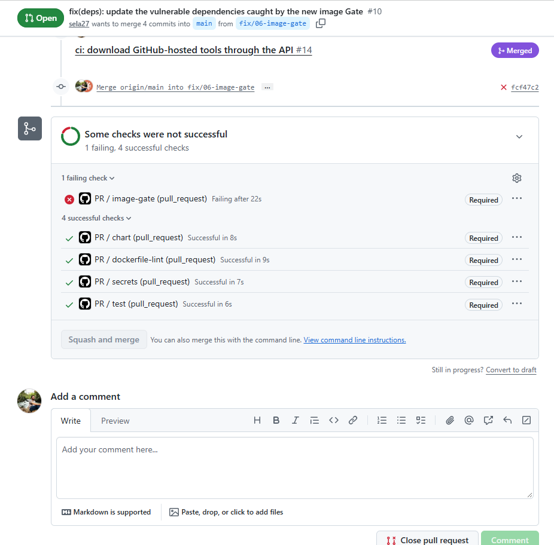

# DevOps Sample Node.js App

## Overview

A lightweight Node.js application. It features basic web endpoints, Prometheus metrics integration, and is designed for Kubernetes deployment and CI/CD pipeline demonstrations.

## Features

- Express.js web server
- Prometheus metrics integration
- Readiness and liveness probe endpoints
- Customizable port via environment variable

## Prerequisites

- Node.js 24 (Active LTS)
- Docker, to build and run the container image

## Quick start

One command brings up a local cluster in which ArgoCD manages everything else from git. You need Docker (Docker Desktop on Windows and macOS), minikube, kubectl and Helm. The script runs from Git Bash on Windows and from bash on Linux and macOS.

```bash
scripts/bootstrap.sh
```

The script starts minikube with the Calico CNI (so NetworkPolicies are enforced) and the metrics-server addon, installs ArgoCD from its pinned Helm chart, and applies the root Application (`gitops/bootstrap/root-app.yaml`). ArgoCD then installs everything declared under `gitops/apps` on `main`. For now that is the Traefik ingress controller ([ADR-0002](docs/adr/0002-traefik-instead-of-minikube-ingress-addon.md)). Re-running the script is safe, because it reuses a running cluster and upgrades ArgoCD in place. It ends by printing how to read the ArgoCD admin password and how to open the ArgoCD UI.

Then start the tunnel in a separate terminal and leave it running. It may ask for admin rights, because it binds ports 80 and 443 on localhost:

```bash
minikube tunnel
```

With the tunnel up, `http://sample-nodejs.127.0.0.1.nip.io/` answers with Traefik's own `404 page not found`, because no app route exists yet. `scripts/verify-bootstrap.sh` checks the whole setup and prints PASS, FAIL or SKIP for each check. The tunnel check runs only while the tunnel is up.

| Variable | Default | Purpose |
| --- | --- | --- |
| `MINIKUBE_PROFILE` | `minikube` | minikube profile and kubectl context |
| `MINIKUBE_CPUS` | `4` | CPUs for the minikube node |
| `MINIKUBE_MEMORY` | `4096` | Memory for the minikube node, in MiB |
| `KUBERNETES_VERSION` | `v1.35.1` | Kubernetes version of the node |
| `ARGOCD_CHART_VERSION` | `10.17.0` (ArgoCD v3.6.1) | `argo/argo-cd` Helm chart version |
| `GIT_REPO_URL` | this repo | Repo the root Application follows |
| `GIT_REVISION` | `main` | Revision the root Application follows. Set it to a pushed branch to try child Applications before they merge, then re-run without it. |

The defaults fit Docker Desktop with about 6 GB of memory. minikube cannot resize an existing cluster, so a new CPU or memory value takes effect only after `minikube delete`. Traefik's version is pinned in `gitops/apps/traefik.yaml` (chart 42.3.1, Traefik v3.7.17).

## Running tests

```bash
npm ci
npm test
```

`npm test` runs Node's built-in test runner (`node --test`) over the `test/` directory. The tests drive the app through real HTTP requests, the same way a client does:

- `test/app.test.js` sends requests with supertest to the exported Express app in-process. It checks the status and body of `/my-app`, `/about`, `/ready`, `/live` and `/classified`, a 404 for an unknown path, and the `/metrics` contract: Prometheus content type, `root_access_total` present, and its value going up by one after a request to `/my-app`.
- `test/entrypoint.test.js` checks that loading `app.js` does not open a port, and that `node app.js` listens on `PORT` (default 8080) and prints `Server running on port <PORT>`.

supertest is a dev dependency only; the app does not need it at runtime.

## Container image

```bash
docker build -t sample-nodejs .
docker run --rm -p 8080:8080 sample-nodejs
curl http://localhost:8080/my-app   # Hello, World!
```

To run it under the same constraints as the hardened pod in the cluster (read-only root filesystem, uid and gid 1000, no capabilities, no privilege escalation), add these flags. `/ready` and `/my-app` answer the same way:

```bash
docker run --rm -p 8080:8080 --read-only --user 1000:1000 \
  --cap-drop ALL --security-opt no-new-privileges sample-nodejs
```

The `Dockerfile` has two stages on the same base image:

- The **build stage** runs `npm ci --omit=dev --ignore-scripts`. It installs production dependencies only, exactly as `package-lock.json` pins them, and runs no install scripts.
- The **runtime stage** copies in only `app.js`, `package.json` and the production `node_modules`. It deletes npm, npx, corepack and yarn, sets `NODE_ENV=production`, runs as the image's built-in `node` user and exposes port 8080. The user is given by number, `USER 1000:1000`, so a runtime can check that it is not root from the image alone, without reading the image's `/etc/passwd`. The app files stay owned by root, so the app process cannot rewrite its own code.

The base image is pinned by its multi-arch digest, with the tag in a comment, so every build starts from the same bytes. Picking up base-image patches means bumping the digest.

`.dockerignore` is an allowlist. Only `app.js`, `package.json` and `package-lock.json` enter the build context. Tests, git metadata, docs, the tracker directory, CI and agent tooling, a local `node_modules` and any stray `.env` never reach the builder. A new source file has to be added there and to the `COPY` line.

### Why `node:24-alpine`

Node 24 is the Active LTS line. Before choosing a base, we scanned the candidates with Trivy 0.58.1 on 2026-11-08 and counted CRITICAL and HIGH findings:

| Base image | CRITICAL | HIGH |
| --- | --- | --- |
| `node:24-alpine` | 0 | 6 |
| `node:22-alpine` | 0 | 10 |
| `node:22-slim` (Debian) | 1 | 44 |
| distroless `nodejs22-debian12` | 1 | 6 |
| Chainguard `node:latest` | 0 | 0 |

Every Alpine finding was in the npm that the image bundles (its copies of `undici` and `brace-expansion`), not in Alpine itself. The app never runs npm, so the runtime stage deletes it. Without npm, `node:24-alpine` scans as clean as Chainguard, while staying an official Docker image with versioned tags on the LTS line. Chainguard's free tier publishes only `latest`, which follows the newest Node release rather than the LTS line. Alpine uses musl instead of glibc, which is fine here because both dependencies are plain JavaScript with no native modules.

A scan of the built image with the same Trivy version finds nothing in Alpine or in Node's tooling. The findings left were in the app's own locked dependencies, not in the base image. The [Image Gate](#image-gate) caught them and the lockfile update fixed them.

The image is about 65 MB compressed. The `node` binary is most of that, and the app's dependencies add about 10 MB.

## Helm chart

The chart lives in `gitops/charts/sample-nodejs/`, inside the `gitops/` directory that ArgoCD reads from this repo ([ADR-0001](docs/adr/0001-gitops-manifests-in-app-repo.md)).

```text
gitops/charts/sample-nodejs/
├── Chart.yaml
├── values.yaml         # chart defaults: everything that is the same in every Environment
├── values-dev.yaml     # the dev Environment: image and Ingress host
└── templates/
    ├── _helpers.tpl    # object name, labels, image reference, app configuration
    ├── configmap.yaml
    ├── deployment.yaml
    ├── serviceaccount.yaml
    ├── service.yaml
    └── ingress.yaml
```

What it renders:

- **Deployment.** One container, listening on port `config.port` (8080), named `http`. Startup and liveness probes call `/live`, the readiness probe calls `/ready`. CPU and memory requests and limits come from `resources` in the values.
- **ConfigMap.** `PORT` (8080) and `NODE_ENV` (`production`) come from `config` in the values, through a ConfigMap that the container loads with `envFrom`. [Variables set in the pod spec override the image's own `ENV`](https://kubernetes.io/docs/tasks/inject-data-application/define-environment-variable-container/), so the ConfigMap's `NODE_ENV` wins over the one the Dockerfile sets. The container port is the same `config.port` value, and the probes and the Service reach the app through that port by name, so `PORT`, the container port and the probes cannot drift apart.
- **Rollout on a config change.** A container reads its environment variables only when it starts, so a changed ConfigMap alone would leave the running pods on the old values. The pod template carries a `checksum/config` annotation, the SHA-256 of the ConfigMap's data. A config change changes the checksum, and with it the pod template, so the Deployment rolls the pods. A change that leaves the ConfigMap as it is keeps the checksum and causes no rollout of its own.
- **Pod hardening.** The pods meet the [restricted Pod Security profile](https://kubernetes.io/docs/concepts/security/pod-security-standards/#restricted): `runAsNonRoot`, uid and gid 1000 (the image's `node` user), the `RuntimeDefault` seccomp profile, `allowPrivilegeEscalation: false` and every capability dropped. The root filesystem is read-only as well. The app writes nothing to disk, so it gets no writable volume, not even `/tmp`. These settings are written in the Deployment template, not taken from values, so no Environment's values file can loosen them.
- **ServiceAccount.** The pods run under their own ServiceAccount, with `automountServiceAccountToken: false` on both the ServiceAccount and the pod, because the app never calls the Kubernetes API. The ServiceAccount carries the registry pull secret for the private image as its `imagePullSecrets` entry. The chart only names the secret (`image.pullSecret`, default `ghcr-pull`); Bootstrap creates it in the app namespace ([ADR-0003](docs/adr/0003-registry-pull-secret-created-at-bootstrap.md)).
- **Service.** `ClusterIP`, port 80 to the container's `http` port (8080). Nothing outside the cluster reaches it directly.
- **Ingress.** `ingressClassName: traefik` and no controller-specific annotations ([ADR-0002](docs/adr/0002-traefik-instead-of-minikube-ingress-addon.md)), so the controller can be replaced without a chart change. The host comes from the Environment's values. There is one `Prefix` rule per Public path, `/my-app` and `/about`, and nothing else. `/classified`, `/metrics`, `/ready` and `/live` have no route, so from outside the cluster they get the controller's 404.
- **Ingress TLS, off by default.** `ingress.tls.enabled: true` gives the Ingress a TLS section for the host, naming the secret `<object name>-tls` (`sample-nodejs-dev-tls` in dev), and one annotation, `cert-manager.io/cluster-issuer`, set from `ingress.tls.clusterIssuer`. cert-manager sees the annotation, has that ClusterIssuer sign a certificate for the host, and keeps it in the secret, where Traefik picks it up. The annotation is read by cert-manager, not by the Ingress controller, so the Ingress still has no controller-specific annotations. With the flag on and no issuer set, the chart refuses to render. See [HTTPS: Let's Encrypt in production, self-signed here](#https-lets-encrypt-in-production-self-signed-here).
- **Labels.** Every object and every pod carries `app.kubernetes.io/name`, `instance`, `version` (the image tag) and `managed-by`, plus Helm's `helm.sh/chart`. The Deployment selector uses only `name` and `instance`, which never change for a release, because a selector cannot be changed after creation.

### Why a Deployment, not a StatefulSet

The app keeps no data on disk, has no database, and needs no per-pod identity. Any pod can serve any request, and pods can be replaced in any order. The one piece of in-memory state, the `root_access_total` counter, is per pod by design: each pod reports its own count and Prometheus sums them, so losing a pod's count when the pod is replaced is expected, not data loss.

A StatefulSet gives stable pod names, ordered start and stop, and a PersistentVolumeClaim per pod. The app uses none of these, and the ordered, one-at-a-time rollout would only make every Deploy slower. A StatefulSet is the right choice for a database, a message broker, or anything that needs a stable network identity or its own volume.

### Values and Environments

- `values.yaml` holds everything that does not depend on the Environment: the app configuration (`config.port` and `config.nodeEnv`), the resources, the name of the registry pull secret, the Ingress class, the list of Public paths and the Ingress TLS flag, off. An Environment that turns the flag on also sets its ClusterIssuer, because the issuer depends on the cluster.
- `values-dev.yaml` holds what the dev Environment adds: the image repository `ghcr.io/sela27/sample-nodejs`, the image tag, and the host `sample-nodejs.127.0.0.1.nip.io`. nip.io resolves that name to 127.0.0.1, where `minikube tunnel` exposes Traefik, so no hosts-file edit is needed.
- The chart refuses to render without an image repository, an image tag, a host and a pull secret name, or with Ingress TLS on and no ClusterIssuer, so a missing value fails at render time, not in the cluster.
- The dev image tag is `0.0.0-placeholder` for now. No Release exists yet, so no image carries a real version. From the first Release on, the Bump commit is the only writer of `image.tag` in `values-dev.yaml`, and it always writes a Release version. No manifest uses `latest`.
- Adding an Environment means adding a `values-<environment>.yaml` and an ArgoCD Application for it, with no chart change.

Chart changes are `chore(chart)` commits, so they never produce a Release. They reach the cluster through ArgoCD, which renders the chart straight from git. For the same reason the chart's own `version` is never published or bumped; the version that matters is the image tag.

### HTTPS: Let's Encrypt in production, self-signed here

In production the ClusterIssuer would be a Let's Encrypt ACME issuer. Let's Encrypt certificates are free, every browser trusts them, and cert-manager renews them before they expire. The chart would not change: the production values file would turn the flag on and name that issuer.

Let's Encrypt only signs for a name once it has checked, from the internet, that the requester controls it: either it fetches a token over HTTP on port 80 of the host (HTTP-01), or it reads a TXT record in the domain's DNS (DNS-01). Neither works for this local setup. `sample-nodejs.127.0.0.1.nip.io` resolves to 127.0.0.1, the loopback address of whichever machine asks, so Let's Encrypt's servers would reach themselves, not this cluster. And the DNS zone belongs to nip.io, so we cannot add a TXT record to it.

So the local setup would use a self-signed ClusterIssuer: cert-manager signs the certificate itself, with no outside party involved. The traffic is encrypted all the same, but no trusted CA vouches for the certificate, so the browser shows a warning. The flag stays off in `dev` until cert-manager runs in the cluster, because without it nothing would issue the certificate.

### Chart check

`scripts/check-chart.sh` is the `chart` check, and runs the same way locally and in CI:

1. `helm lint --strict` with the dev values, and again with Ingress TLS on. Warnings fail too.
2. `helm template` with the dev values, and again with Ingress TLS on (`ingress.tls.enabled=true` and a test ClusterIssuer name). A third render, with TLS on and no issuer, must fail.
3. kubeconform in strict mode, over both renders, against the schemas of Kubernetes 1.35.1, the version Bootstrap runs. Strict mode also rejects unknown fields, such as a misspelled `containerPorts`, and duplicate keys, which Kubernetes would otherwise drop without a word.
4. Assertions on the rendered manifests. The expected values come from the spec, not from the chart, so a chart edit cannot quietly move them: the Ingress serves exactly the Public paths, with class `traefik`, no annotations, no TLS section and the dev host; the probes call `/live` and `/ready` on the container port; the container listens on 8080; the Service is `ClusterIP`, maps 80 to 8080 and selects the app's pods; the Ingress points at that Service; the image is `ghcr.io/sela27/sample-nodejs` with a fixed tag, never `latest`; the pod hardening holds (non-root as uid and gid 1000, `RuntimeDefault` seccomp, read-only root filesystem, no privilege escalation, all capabilities dropped and none added); the pods run under the chart's ServiceAccount, mount no API token and get the `ghcr-pull` secret; `PORT` (8080) and `NODE_ENV` (`production`) reach the app from the ConfigMap, and the pod template carries the `checksum/config` annotation; and every object and pod has the standard labels. A security setting may sit on the pod or on the container; the check reads the value the kubelet applies, the container's own if set, else the pod's. An environment variable is resolved the same way: an `env` entry wins over `envFrom`, a later `envFrom` source over an earlier one, and both over the image's `ENV`. So an `env` entry that shadows the ConfigMap fails the check, as does a reference to a ConfigMap the chart does not render.
5. Assertions on the TLS-on render: the Ingress has one TLS entry, for the dev host, that names a secret; its only annotation is `cert-manager.io/cluster-issuer`, set to the issuer the check passed in; and with those two taken out, the render is the same as the default one, object for object, so the flag changes nothing else.
6. Renders with one value changed, to check what a values change does. Another `config.nodeEnv` reaches the app over the image's `NODE_ENV` and changes the checksum. Another `config.port` moves `PORT`, the container port, the probes and the Service's target together, and changes the checksum. A change outside the ConfigMap, such as `replicaCount`, keeps the checksum.

Each failure prints what was expected and what the chart rendered. If the dev values added `/classified` to the Public paths, for example, the check fails with `expected: /about /my-app | got: /about /classified /my-app`.

## Pipeline

Every pull request to `main` runs these checks, defined in `.github/workflows/pr.yml`:

| Check | What it runs | Fails when |
| --- | --- | --- |
| `test` | `npm ci --ignore-scripts`, then `npm test`, on Node 24 | any test fails |
| `dockerfile-lint` | hadolint 2.15.1 on `Dockerfile` | any finding of severity warning or error (info and style findings are printed but pass) |
| `chart` | `scripts/check-chart.sh`: helm 4.1.4 lint, render with the dev values, kubeconform 0.8.0 strict against Kubernetes 1.35.1, then assertions on the rendered manifests with yq 4.54.1 | a lint warning or error, a schema violation, or a rendered manifest that breaks the chart's contract, such as an Ingress path that is not a Public path |
| `secrets` | gitleaks 8.30.1 with its default rules over every commit the PR brings, the ones reachable from the PR head but not from `main`, with full history fetched | any finding, including a secret added in one commit and removed in a later one, because it stays in the PR's history on GitHub |
| `image-gate` | builds the image with BuildKit and keeps it on the runner, then scans it with Trivy 0.76.2 ([Image Gate](#image-gate)) | any HIGH or CRITICAL vulnerability, including one with no fixed version yet, that `.trivyignore` does not list |

Each check is its own job, so a failure shows as its own red check on the PR. The check names are a contract with the [branch protection](#branch-protection) on `main`, which requires them by name. No job sets `name:`, so GitHub names each check after its job id. The PR page shows `PR / test (pull_request)`, but the name the ruleset matches is the bare job id, `test`. A job id therefore never changes unless the ruleset changes in the same PR. New Gates are added as new jobs at the end of the workflow, as new rows in this table, and as required checks in `scripts/protect-main.sh`.

To run the same checks locally:

```bash
npm ci && npm test
docker run --rm -i ghcr.io/hadolint/hadolint:v2.15.1 hadolint --failure-threshold warning - < Dockerfile
scripts/check-chart.sh   # needs helm 4, kubeconform and yq 4 on PATH
gitleaks git --redact --verbose --log-opts="origin/main..HEAD"   # needs gitleaks 8 on PATH
docker build -t sample-nodejs:local . && trivy image --image-src docker --scanners vuln \
  --severity HIGH,CRITICAL --ignorefile .trivyignore --exit-code 1 sample-nodejs:local   # needs trivy 0.76.2
```

### Image Gate

`image-gate` builds the image the way a Release will, and blocks the PR while that image carries a known HIGH or CRITICAL vulnerability.

1. `docker buildx build --load` builds the image with BuildKit and loads it into the runner's Docker engine. Nothing is pushed and no step logs in to a registry, so on a PR the image never leaves the runner.
2. Trivy scans that local image (`--image-src docker`, so it never pulls an image from a registry): the Alpine packages and the app's production dependencies in `node_modules`.
3. Any HIGH or CRITICAL finding fails the check, including one that has no fixed version yet, because `--ignore-unfixed` is deliberately not set. The findings table is printed in the job log.

**It caught real vulnerabilities on its first run.** [PR #10](https://github.com/sela27/sample-nodejs/pull/10) added the Gate in a commit of its own, and the check went red on the dependencies the sample app had locked:

| Package | Severity | Installed | Fixed | Vulnerability |
| --- | --- | --- | --- | --- |
| `proxy-addr` | CRITICAL | 2.0.7 | 2.0.8 | CVE-2026-90711: IP spoofing via an IPv4-mapped IPv6 trust subnet |
| `body-parser` | HIGH | 1.20.3 | 1.20.9 | CVE-2026-111181: denial of service via an unhandled decompression stream error |
| `path-to-regexp` | HIGH | 0.1.12 | 0.1.13 | CVE-2026-4867: denial of service via catastrophic backtracking on malformed URL parameters |

All three are transitive dependencies of Express 4.21.2. Alpine 3.24.4 had no findings, because the runtime stage already drops npm. `npm audit` also marks `express` itself as high, only because it depends on these packages; Trivy reports the packages that carry the advisories.

The ruleset already required `image-gate` at that point, so the PR could not merge. The screenshot shows `PR / image-gate` failing and marked Required, the other four checks green and Required, and "Squash and merge" disabled:



A second commit in the same PR ran `npm audit fix --ignore-scripts`. It updated `package-lock.json` inside the ranges `package.json` already allowed, and left `package.json` unchanged:

| Package | Before | After |
| --- | --- | --- |
| `express` | 4.21.2 | 4.22.3 |
| `body-parser` | 1.20.3 | 1.20.9 |
| `path-to-regexp` | 0.1.12 | 0.1.13 |
| `proxy-addr` | 2.0.7 | 2.0.8 |
| `qs` (moderate findings only) | 6.13.0 | 6.16.2 |
| `raw-body` | 2.5.2 | 2.5.3 |

Express stays on 4.x, `npm audit` reports 0 vulnerabilities, the tests pass, and `image-gate` went green with the other four checks. The fix could not come in a separate PR from `main`: that PR would not contain the Gate, which existed only on this unmerged branch, so it could never pass the required check. The PR is titled `fix(deps): …`, so its squash commit is the fix that drives the first Release.

**Why Trivy is a pinned binary, not the action.** The tags of `aquasecurity/trivy-action` and `setup-trivy` were hijacked on 2026-03-19 (CVE-2026-33634), and Trivy 0.69.4 and the Docker Hub images 0.69.5 and 0.69.6 were malicious ([GHSA-69fq-xp46-6x23](https://github.com/aquasecurity/trivy/security/advisories/GHSA-69fq-xp46-6x23)). The job therefore uses neither action. It downloads the Trivy 0.76.2 release file with `gh release download` and checks it against a pinned SHA-256 before it runs, the same way as the `chart` job's tools. 0.76.2 was chosen because:

- it is outside the compromised 0.69.4–0.69.6, and newer than every fix in Trivy's published advisories (the latest is 0.72.0, on 2026-06-30);
- it is a GitHub immutable release, so its files cannot be replaced after publication. `gh release verify v0.76.2 -R aquasecurity/trivy` checks the release attestation, and `cosign verify-blob` confirms that `trivy_0.76.2_checksums.txt` was signed by Trivy's own release workflow at tag `v0.76.2`. That file lists the pinned SHA-256;
- it is the current patch release, with the 0.76.2 security fixes in Trivy's own dependencies.

Like the other tools hosted on GitHub releases, the file is fetched through the GitHub API with the job's read-only token, not from the anonymous `github.com/.../releases/download` URL. That URL returned 504 during a GitHub incident on 2026-11-09 and failed this PR's first run, while the API kept serving the same file.

**The ignore file.** `.trivyignore` lists the vulnerability IDs the Gate accepts, and it is empty. Fixing means a dependency or base-image update, not an entry there. An entry is allowed only for a finding that cannot be fixed yet, with a comment directly above it giving both the justification (why it cannot be fixed now, for example no fixed version exists) and the reason it is safe (why the vulnerable code cannot be reached or exploited in this image). An entry without both is not merged, and the PR that ships the fix removes the entry.

### Supply chain and permissions

- Every third-party action is pinned by full commit SHA, with the version in a trailing comment, for example `actions/checkout@3d3c42e5aac5ba805825da76410c181273ba90b1 # v7.0.1`. A tag can be moved to other code, a commit SHA cannot. The tags of `aquasecurity/trivy-action` and `setup-trivy` were hijacked on 2026-03-19 (CVE-2026-33634), and only workflows pinned by SHA were safe from the swap. The SHAs come from the actions' release tags through `gh api repos/<owner>/<repo>/git/ref/tags/<tag>`, with annotated tags dereferenced to their commit.
- The hadolint action pins its own hadolint image by digest, so pinning the action also fixes the linter version.
- Tools that do not come as actions (helm, kubeconform and yq in the `chart` job, gitleaks in the `secrets` job, Trivy in `image-gate` and in the release `image` job) are downloaded at a pinned version and checked against a pinned SHA-256 before they run. The runner's preinstalled helm and yq are not used.
- gitleaks prints its findings redacted, so the job log of this public repo does not repeat a leaked value.
- Each workflow's default token permission is `contents: read` and nothing else. A job that needs more asks for it in its own `permissions:` block. Only the release workflow does, as listed in [Release flow](#release-flow).
- `actions/checkout` runs with `persist-credentials: false`, so the token is not left in the git config for later steps.
- `npm ci --ignore-scripts` keeps dependency install scripts from running on the runner, the same as in the image build.
- A new push to a PR cancels that PR's run still in progress. A release run is never cancelled.

## Release flow

A squash merge into `main` becomes one commit, and its message is the PR title, a Conventional Commit. That commit type alone decides whether the merge produces a Release. `.github/workflows/release.yml` runs on every push to `main` and never on a pull request.

| Commit type | Release |
| --- | --- |
| `feat` | minor, for example 1.2.0 to 1.3.0 |
| `fix`, `perf`, or a revert | patch, for example 1.2.0 to 1.2.1 |
| any type with a breaking change (`feat!:` or a `BREAKING CHANGE:` footer) | major, for example 1.2.0 to 2.0.0 |
| `ci`, `docs`, `chore`, `build`, `test`, `refactor`, `style` | none |

The first Release is 1.0.0, whatever the type. Only changes to the app or its production dependencies use `feat` or `fix`. Chart, cluster, CI, build, test and docs changes use the other types, so they never ship a new image.

The run has three jobs. Each one starts only if the one before it succeeded:

1. **`version`** runs semantic-release in dry-run mode (`release/next-version.mjs`). It reads the commits since the last `v*` tag, logs a verdict for each commit and the release notes it would publish, and creates nothing. If no commit warrants a Release, it logs `No Release from this commit`, and the run ends there, green, with the other two jobs skipped.
2. **`image`** builds the image with BuildKit, tagged with the version and with `sha-<short commit>`. It then runs the image Gate on it, with the same pinned Trivy 0.76.2, flags and `.trivyignore` as the `image-gate` PR check. Only then does it log in to GHCR and push both tags to the private package `ghcr.io/sela27/sample-nodejs`. The scan runs again on `main` because a vulnerability can be published between the PR check and the merge.
3. **`release`** runs semantic-release for real. It tags the commit `v<version>`, pushes the tag, and creates the GitHub Release with the notes. A last step checks that the tag exists. semantic-release exits 0 without releasing when `main` has moved on since the run started, and the run must not look green when an image was pushed without its Release.

**A Gate failure leaves nothing behind.** When the scan fails, the `image` job stops at that step. Its login and push steps show as skipped, so nothing reaches GHCR. The `release` job is skipped as well, so no tag and no GitHub Release are created. The job order guarantees this. The job that creates the tag starts only after the job that pushes, and that job pushes only after the scan passes.

**Job permissions.** The workflow default is `contents: read`. Each job raises only what it uses, and no job gets `issues`, `pull-requests`, `id-token` or `attestations`.

| Job | Token permissions | Why |
| --- | --- | --- |
| `version` | `contents: write` | Before it analyzes anything, semantic-release checks with `git push --dry-run` that it could push the tag, even in dry-run mode. GitHub refuses that check to a read-only token. The job pushes nothing. |
| `image` | `contents: read`, `packages: write` | Push the image to GHCR. |
| `release` | `contents: write` | Push the tag and create the GitHub Release. |

**One run at a time.** All release runs share one concurrency group, and a run in progress is never cancelled, because a cancelled run could leave an image in GHCR without its Release. A push that lands meanwhile waits. GitHub keeps only the newest waiting run and cancels older waiting ones. That loses nothing, because semantic-release reads every commit since the last Release tag, so the newest run releases them all. The Bump commit will carry `[skip ci]`, so GitHub starts no run for it.

**The semantic-release config**, in `.releaserc.yaml`:

- The release branch is `main`, and tags are `v${version}`.
- The commit analyzer and the release notes generator use the `conventionalcommits` preset. The notes list features, bug fixes, performance improvements and reverts, and leave out `ci`, `docs`, `chore`, `build`, `test`, `refactor` and `style` commits.
- The GitHub plugin creates the GitHub Release. It is set not to comment on the released PRs and not to open an issue when a release fails, because both would need write access to issues and pull requests.
- There is no npm plugin, so nothing is published to the npm registry, and no git plugin, so nothing is committed back. The git tag is the source of truth for the version. `package.json` keeps its `version` field as it is, and there is no `CHANGELOG.md`, because the notes live in the GitHub Release.

**Pinned release tooling.** `release/package.json` pins semantic-release 25.0.9 and `conventional-changelog-conventionalcommits` 9.3.1 exactly, and `release/package-lock.json` pins every package below them, with its integrity hash. Both semantic-release jobs install it with `npm ci --ignore-scripts` and no dependency cache. It is a separate manifest, rather than root dev dependencies or `npx`:

- `npx semantic-release@25.0.9` pins only the top package. Its roughly 300 dependencies would resolve afresh from version ranges on every run, so a bad release of any of them would run in a job that holds a write token. The lockfile fixes the whole tree.
- Root dev dependencies would add those packages to the app's lockfile, to every `test` job install and to `npm audit` of the app, for tooling the app never runs.
- The `.dockerignore` allowlist keeps `release/` and `.releaserc.yaml` out of the build context, so the image is unchanged.

The preset is 9.3.1, not the newer 10.x. The 10.x preset needs `conventional-changelog-writer` 9, while the release notes generator that semantic-release 25.0.9 bundles uses writer 8. With 10.4.1, the dry run failed at the `generateNotes` step.

**The first Release.** A dry run on 2026-11-10 predicted `v1.0.0`. It ran over `main` at `510c9f5` plus this pipeline's own `ci:` commit, the way the `version` job will run after the merge. Of the 18 commits it analyzed, only `fix(deps): update the vulnerable dependencies caught by the new image Gate (#10)` warrants a Release (a patch). Every `ci`, `docs`, `chore`, `build` and `test` commit, the pipeline's own included, warrants none. The notes it would publish, with the date of the run:

```markdown
## 1.0.0 (2026-11-10)

### Bug Fixes

* **deps:** update the vulnerable dependencies caught by the new image Gate ([#10](https://github.com/sela27/sample-nodejs/issues/10)) ([1511b7b](https://github.com/sela27/sample-nodejs/commit/1511b7b320b07f866fa7467623f90fc435d5dab6))
```

The first push creates the GHCR package, which is private by default. The image's `org.opencontainers.image.source` label tells GHCR which repo the package belongs to. After that first push, the package settings are checked by hand: the package must be private and linked to this repo.

To preview the next Release locally, run the same dry run as the `version` job from an up-to-date `main`. The token lets the GitHub plugin check the repo. Nothing is tagged or published.

```bash
npm ci --prefix release --ignore-scripts
GITHUB_TOKEN="$(gh auth token)" node release/next-version.mjs
```

Run it only on `main`. On any other branch, semantic-release force-updates the local `main` from GitHub before it declines to release.

## Branch protection

`main` is protected by a repository ruleset named `protect-main`, and the repo allows squash merges only. `scripts/protect-main.sh` applies both through `gh api`, so the protection is reproducible and reviewable as code. `scripts/verify-protection.sh` reads the live settings back from GitHub and prints PASS or FAIL for each rule. Both need `gh`; applying needs a repo admin.

```bash
scripts/protect-main.sh         # create or update the ruleset and the merge settings
scripts/verify-protection.sh    # check what GitHub actually enforces
```

The ruleset applies to `refs/heads/main` and is active:

- **A pull request is required**, with zero approvals, because there is a single maintainer. The checks are the review. The ruleset itself also allows squash merges only.
- **The required status checks are the PR jobs**: `test`, `dockerfile-lint`, `chart`, `secrets` and `image-gate`. Each one is bound to the GitHub Actions app, so only a workflow job can turn it green, not another app or a commit status posted with a personal token. A branch does not have to be up to date with `main` before it merges. The Bump commit will land on `main` after every Release, and requiring up-to-date branches would make every open PR re-run its checks each time.
- **Force-push and deletion of `main` are blocked.**
- **Nobody can bypass it**, the repo admin included: the bypass list is empty. The Bump commit will be the one exception. The pipeline pushes it with a deploy key that goes on the bypass list ([ADR-0001](docs/adr/0001-gitops-manifests-in-app-repo.md)), added through the same script.

The repo merge settings:

- **Squash merging only.** Merge commits and rebase merging are turned off, so each PR becomes exactly one commit on `main`.
- **The squash commit message is the PR title** (GitHub's "Default to pull request title"), with an empty body. The PR title is a Conventional Commit, so it alone decides whether the merge produces a Release.
- **The head branch is deleted after the merge.**

While a required check is pending or failing, the PR page shows "Merging is blocked" and `gh pr merge` refuses. Once all of them are green, merge with `gh pr merge --squash` or the "Squash and merge" button. `--merge` and `--rebase` are refused.

To add a Gate, add its job to `.github/workflows/pr.yml` and append its job id to `REQUIRED_CHECKS` in `scripts/protect-main.sh` in the same PR. Then apply the script from the Gate's branch once its PR is open and before it merges, so the PR that adds the Gate is already held to it. `scripts/verify-protection.sh` fails while the required checks and the PR jobs in `pr.yml` differ, which also catches a renamed job.

## Security controls

Each security control in the delivery path, where it is enforced, and what it stops.

| Control | Where | What it stops |
| --- | --- | --- |
| Non-root, as uid and gid 1000 | Image `USER 1000:1000`; pod `runAsNonRoot`, `runAsUser`, `runAsGroup` | A container running as root. The kubelet refuses to start the container if it would run as uid 0. |
| Read-only root filesystem | Container `readOnlyRootFilesystem: true` | A compromised process rewriting the app or dropping tools into the container. The app needs no writable path. |
| No privilege escalation | Container `allowPrivilegeEscalation: false` | A process gaining privileges through setuid or setgid binaries. |
| All Linux capabilities dropped | Container `capabilities.drop: [ALL]` | The process holding or regaining kernel privileges, such as opening raw sockets, changing file ownership or bypassing file permissions. |
| `RuntimeDefault` seccomp profile | Pod `seccompProfile` | System calls outside the container runtime's default allowlist, which shrinks the kernel surface an exploit can reach. |
| No Kubernetes API token | ServiceAccount and pod `automountServiceAccountToken: false` | A compromised pod using an API token to read or change cluster objects. |
| Registry pull secret outside git | ServiceAccount `imagePullSecrets` by name; the secret is created at Bootstrap ([ADR-0003](docs/adr/0003-registry-pull-secret-created-at-bootstrap.md)) | The `read:packages` token reaching the repo. |
| Secret scanning | The `secrets` check on every PR (gitleaks), required on `main` by the ruleset | A PR that carries a credential, in any of its commits, from merging into `main`. The check cannot unpublish a secret that was already pushed, so a finding also means rotating it. GitHub push protection, enabled on this repo, is an extra layer in front: it refuses a push that carries a known provider's token format, while gitleaks also catches generic high-entropy keys. |
| Image vulnerability scanning | The `image-gate` check on every PR (Trivy), required on `main` by the ruleset, and the same scan in the release run before the push | A PR whose image carries a known HIGH or CRITICAL vulnerability, in Alpine or in the app's dependencies, from merging into `main`, including one with no fixed version yet. On `main`, the same scan stops a vulnerable image from reaching GHCR, which also means no tag and no Release. The only ways past it are a fix, or a `.trivyignore` entry whose justification is reviewed in the PR. |
